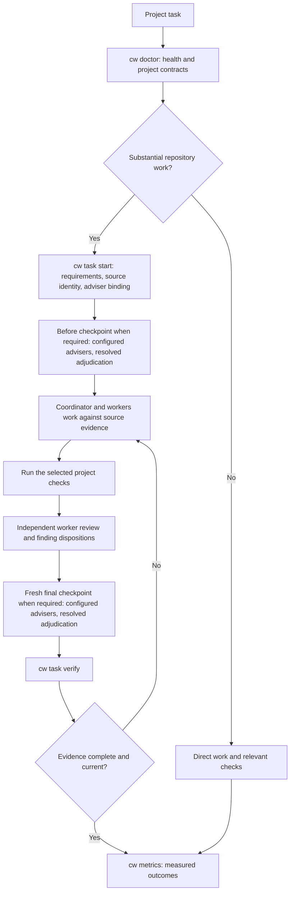
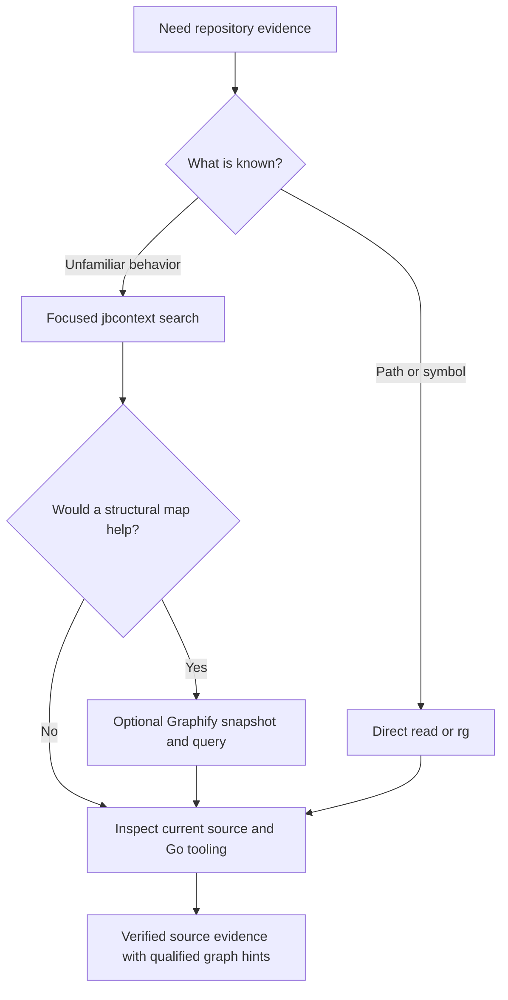

# agent-workflows

A Go skill manager for personal agent workflows on macOS and Linux. Install
editable skills, model policy, and shared instructions for Codex, Claude Code, or
both, as verified, immutable snapshots. Updates are manual and reversible.

This guide covers the [current release](https://github.com/belevtsev/agent-workflows/releases/latest).

## Install

```sh
curl -fsSL https://raw.githubusercontent.com/belevtsev/agent-workflows/main/install.sh | sh
```

The installer downloads a verified binary with its workflow resources included.
There is no repository clone, Go build or Git requirement. Releases support
macOS and Linux on ARM64 and AMD64. The small download helper uses `curl`, `tar`,
and `sha256sum` or macOS `shasum`; alternatively unpack your platform archive from
the release page and run `./cw install`.

In a terminal, setup opens a guided full-screen interface with four steps: hosts,
models, optional API keys, and a review before anything is applied. Answered steps
collapse to one line, and the review shows each host's models by role group.
Keys: ↑/↓ move, Space toggles a checkbox, Enter continues, ← or Backspace goes
back with your earlier answers kept, and Esc asks before quitting; Ctrl-C quits at
once. Quitting before apply leaves your configuration unchanged. After applying,
setup prints a short summary instead of the JSON report. Use `--plain` for a
line-based interface (type a number, `b` to go back, `q` to quit). Updates
default to keeping saved choices. Named presets explicitly replace existing
overrides:

| Choice | Codex substantive work | Claude substantive work |
| --- | --- | --- |
| Recommended | Sol 6.1 / max | Opus 5.5 / high; xhigh for planning, architecture and diagnosis |
| Balanced | Sol 6.1 / xhigh | Opus 5.5 / high for every substantive role |
| Advanced | Each role, fallback and memory/context field separately | Each role and fallback separately |

The models step also has a GitHub workers row for each selected host. It sets one
model and reasoning effort for the commit, routine PR text and PR submission
roles, which default to Luna/high on Codex and Sonnet 5.5/medium on Claude.
Choosing a preset keeps the GitHub worker choice shown there, and choosing the
release default unpins it. Scripts set these roles with `--settings`. Unset preference fields follow future release defaults;
explicit fields remain pinned, including a value equal to today's default.
Advanced opens a menu so you can edit one role or memory setting directly; each
row shows its current value. Clear a text field (or type `default` in the plain
interface) to follow the release default again.

For scripts, select hosts and preferences explicitly:

```sh
cw install --host all --preset recommended --non-interactive
cw update --non-interactive
```

`--json`, piped input/output, `--non-interactive` and dry runs never open the
terminal interface and always write the JSON report to stdout. Use
`--settings FILE` instead of `--preset` to load nonsecret version-one preferences.

This source requires a published `cw-manager-v10` release. Personal
configuration is not updated by publishing a release. If a `cw` older than v2.0.58
installed your skills, see [moving from an older install](#moving-from-an-older-install).

Installation registers 33 skills with 78 entrypoints on each selected host, and
adds the same managed instructions to both:

| | Codex | Claude Code |
| --- | --- | --- |
| Skills | `~/.agents/skills/<name>` | `~/.claude/skills/<name>` |
| Instructions | Managed block in `$CODEX_HOME/AGENTS.md` | Managed block in `~/.claude/CLAUDE.md` |
| Settings | `model`, `model_reasoning_effort`, `model_context_window` and five memory keys in `config.toml` | `model` and `effortLevel` in `settings.json` |
| Custom location | `--codex-home` or `CODEX_HOME` | `--claude-home` or `CLAUDE_CONFIG_DIR` |

The Claude Code defaults come from the coordinator profile in
[model-policy.claude.yaml](skills/task-orchestration/model-policy.claude.yaml):

```json
{
  "model": "claude-opus-5-5",
  "effortLevel": "high"
}
```

The Codex defaults come from
[model-policy.yaml](skills/task-orchestration/model-policy.yaml) and
[global/codex-defaults.toml](global/codex-defaults.toml):

```toml
model = "gpt-6.1-sol"
model_reasoning_effort = "max"
model_context_window = 512000

[features]
memories = true

[memories]
generate_memories = true
use_memories = true
extract_model = "gpt-6.1-sol"
consolidation_model = "gpt-6.1-sol"
```

Unrelated settings, permissions and local content are preserved on both hosts.
`settings.json` edits change only those two keys and keep every other byte. If you
or Claude Code later change one of them, it stays yours: `cw status` reports it as
`settings_drift`, and update, rollback and uninstall leave it alone. Each device
keeps its own configuration. In `config.toml`, use ordinary TOML tables or dotted
keys for the shared settings; inline `features` or `memories` tables must be
converted before installation.

Historical shared defaults with only the five memory keys remain supported.
Acquiring the context window saves its current personal value or absence;
returning to a five-key snapshot restores it and releases its ownership. Retained
keys keep their saved originals. See [shared configuration](docs/operations.md#shared-codex-configuration).

Under Claude Code, your `code-review` skill replaces the bundled `/code-review`.
The `/review` alias still runs the bundled one.

Setup links `~/.local/bin/cw` directly to the installed binary and adds a managed
PATH entry to your Bash/zsh startup file when needed. Open a new terminal, then:

```sh
cw version
cw status
```

The installed command works from any directory. `cw update` pins one stable
release and verifies its tag, platform archives, checksums, source revision and
embedded payload before activation. Status, rollback, recovery and uninstall
work from recorded roots and cached snapshots. A skill rollback retains the
capable manager and your current preferences. Re-running install on a standalone
installation reconfigures its active cached base, including after rollback;
`cw update` is the command that selects a newer release.

Use `cw install --dry-run` for a local preview without downloads or persistent
writes. A cold `install.sh --dry-run` reports deferred validation. See
[operations](docs/operations.md) for custom paths and recovery.

### Private API keys

Setup can optionally save `TYPESAFE_API_KEY`, `SUBQ_API_KEY` and `OPENAI_API_KEY`
in a local plaintext `credentials.json`, with an owner-only directory and file.
Environment variables win per provider. Keys are read only by adviser calls,
the optional synthetic online check, and explicitly hosted evaluation; they are
not copied into host settings or unrelated subprocesses. Online checking is off
by default. Missing keys do not block installation; an adviser without its key
simply does not participate. See [configure advisers](#configure-advisers).

Preferences and credentials live under `$XDG_CONFIG_HOME/agent-workflows` or
`~/.config/agent-workflows`; `--config-dir` selects a different initial directory.
That absolute location is recorded and remains authoritative after XDG changes.
Uninstall preserves these user-owned files. A credential-save or online-check
failure after settings activation reports a nonzero partial result; it does not
pretend that already-applied settings were rolled back.

### Add or remove a host

Run `cw install --host codex` or `cw install --host claude` and review the setup.
Existing ownership and unrelated personal content remain protected.

To drop one host and keep the other:

```sh
cw uninstall --host codex
```

If that host's files are already gone, add `--forget` so the record is removed
without restoring anything:

```sh
cw uninstall --host codex --forget
```

### Go diagnostics in Claude Code

Claude Code gets live Go diagnostics and navigation from the `gopls-lsp` plugin. It adds no context cost and needs `gopls` on your `PATH`.

```bash
claude plugin marketplace add anthropics/claude-plugins-official
```

```bash
claude plugin install gopls-lsp@claude-plugins-official
```

Use this marketplace, not the built-in directory. `gopls-lsp@anthropic-plugin-directory` installs without error but contains no language server. Check with `claude plugin details gopls-lsp@claude-plugins-official`, which should list `LSP servers (1)`.

### Moving from an older install

This `cw` does not read an installation made by a `cw` older than v2.0.58
(source-checkout installs and codex-workflows v1), or one that v2.0.58 migrated
from such an install; it refuses one it finds and changes nothing. Move once. First, using your existing `cw`:

```sh
cw uninstall
```

Then run the download installer, with `--adopt-personal-skills` if you had
adopted personal skills:

```sh
curl -fsSL https://raw.githubusercontent.com/belevtsev/agent-workflows/main/install.sh | sh -s -- --host all --adopt-personal-skills
```

Old task records and rollback history do not carry over; start new tasks with
`cw task start`.

### Compatibility with earlier releases

This release keeps one current format for each file and does not convert older ones:

- Task records and consultation records from earlier releases do not load. This
  release reads only task record version 3 and consultation record version 4.
  Restart in-flight tasks with `cw task start`.
- Model policies older than version 3 are rejected.
- `cw consult` no longer accepts `--with-openai` or `--without-openai`; adviser
  participation follows [configuration](#configure-advisers).
- On an installation made by an older `cw`, this `cw` refuses install, update,
  rollback, recover and uninstall before any change. Run `cw uninstall` with your
  existing `cw`, then install again as shown above. Until you reinstall,
  `cw consult` and `cw task start` keep working, but they read adviser keys only
  from the environment and the default config directory, not from a config
  directory that the older installation recorded.

## Current model policy

Codex and Claude Code keep separate roles, and the rest of the policy is shared.

| Role | Codex | Claude Code |
| --- | --- | --- |
| Coordination, substantive work, review, and final verification | `gpt-6.1-sol` at `max` | `claude-opus-5-5` at `high` |
| Planning, architecture and diagnosis (`decision`) | `gpt-6.1-sol` at `max` | `claude-opus-5-5` at `xhigh` |
| Routine commit, PR drafting from verified facts, and submission (`github`) | `gpt-6-luna` at `high` | `claude-sonnet-5-5` at `medium` |
| Other bounded execution profiles | `gpt-6-luna` at `xhigh` | `claude-opus-5-5` at `high` |
| Bounded evidence gathering | `gpt-6-luna` at `high` | `claude-opus-5-5` at `high` |

Activated substantial work with an open decision (real alternatives with
consequential uncertainty) has a before-implementation and a final-review
checkpoint on both hosts. When the approach follows directly from the defect or
contract and no changed code must behave alike on several platforms or shells, the
plan declares `"checkpoints": {"required": false, "reason": "..."}`
and `cw task verify` lists the reason; when in doubt, it keeps them. Advisers are optional: one takes part only when it is
enabled in the shared policy's `consultation.providers` and its key is present.

| Adviser | Provider ID | Model | Enabled by default | Key |
| --- | --- | --- | --- | --- |
| SubQ Snap | `subq_snap` | `subq-snap-preview` | Yes | `SUBQ_API_KEY` |
| OpenAI Decisions | `openai_decisions` | `gpt-6-luna` | Yes | `OPENAI_API_KEY` |
| TypeSafe Jev | `jev` | exact version, such as `jev-1.14.0` | No (opt-in) | `TYPESAFE_API_KEY` |

Reasoning effort is managed by each provider. `cw task start` binds the advisers
configured at that moment, so later policy or key changes do not alter a running
task. With none configured, each checkpoint is still adjudicated, on source
evidence and checks alone.

The editable [Codex policy](skills/task-orchestration/model-policy.yaml) and
[Claude Code policy](skills/task-orchestration/model-policy.claude.yaml) define
dispatch roles; advisers come from the shared policy. [Host mapping](skills/task-orchestration/references/hosts.md) covers
what differs in practice. The coordinator checks actual runtime model metadata; a
saved policy does not switch an existing chat or prove account availability. It
makes the final decision from source evidence and verification, considering the
configured advisers at equal standing.

Requested commits and routine PR creation/update explicitly use the
[`github` worker](skills/task-orchestration/references/github-worker.md), including
small tasks. It drafts messages and descriptions from verified facts and performs
scoped authorized commit/push and `gh` PR writes with prewrite refresh and readback.
Substantive PR authoring stays with the coordinator or substantive worker. Routine
publication alone adds no full orchestration or adviser calls. If compatible
GitHub dispatch is unavailable, report the blocker rather than silently using an
expensive worker. Codex dispatch uses explicit model/effort and no forked history;
Claude uses Agent `model: sonnet`, `effort: medium` on 2.1.292 or newer. Verify the
effective runtime metadata because aliases and environment overrides can change it.

The persisted Claude Code `effortLevel` follows the coordinator profile, `high` by
default; `xhigh` remains for the decision roles. `settings.json` rejects `max`,
so use `/effort max` for a session.

## Included skills

| Registration | Purpose |
| --- | --- |
| task-orchestration | Coordinate substantial work, models, assumptions, and evidence |
| production-plan | Build context-grounded implementation plans with independent design challenges |
| code-review | Review correctness and compatibility risks |
| go-principal-engineer | Resolve production Go ownership and lifecycle decisions |
| software-architecture | Assess boundaries and interface evolution |
| codebase-design | Design deep modules with small interfaces and real seams |
| domain-modeling | Sharpen domain language and record hard-to-reverse decisions |
| parse-dont-validate | Turn repeated checks into types parsed at the boundary |
| expand-contract | Plan zero-downtime schema, API, and event changes |
| isolation-anomalies | Find write skew and lost updates in transactions |
| retry-amplification | Prevent retry storms and failures that outlive their cause |
| clocks-and-time | Avoid wall-clock, skew, time zone, and DST bugs |
| test-strategy | Choose verification for changed behavior |
| security-threat-model | Build a repository-grounded threat model |
| backend-security-review | Scope backend security checks and verify findings against reachable paths |
| protobuf-contracts | Review binary, generated API, and ProtoJSON evolution and peer compatibility |
| go-pki-mtls | Review reusable certificate, trust, and service identity lifecycles |
| cc-skills-golang | Go specialist skills |
| db-postgres | Diagnose PostgreSQL against actual evidence |
| archify | Render portable, inspectable architecture and workflow diagrams |
| graphify | Explore tracked Go source with a local structural graph |
| typesafe-ai | Use TypeSafe and Jev for scoped judgments |
| docker-agent-config | Author Docker Agent configuration |
| docker-agent-deploy | Expose Docker Agents through the requested server interface |
| docker-agent-run | Run Docker Agents with the appropriate execution mode |
| docker-build-strategies | Create and improve Dockerfiles |
| docker-compose-patterns | Configure and diagnose Docker Compose |
| docker-destructive-guardrails | Check authorization and scope before destructive Docker actions |
| docker-project-foundations | Establish Docker project configuration |
| docker-sandboxes-env | Author declarative sandbox environments |
| docker-sandboxes-kits | Package and validate sandbox kits |
| docker-sandboxes-lifecycle | Manage sandbox creation, execution, and removal |
| docker-sandboxes-network-credentials | Configure sandbox networking and credential access |


See [third-party notices](THIRD_PARTY.md). Skills keep their own optional
dependencies. Archify requires Node.js 18+ and Chrome/Chromium for browser checks;
Graphify needs a separately provisioned `graphify` executable from the pinned
`graphifyy==0.9.103` Python package; Docker skills require the corresponding Docker
tools and platform support.
`cw doctor --repo PATH` reports the optional `gopls`, `graphify` and `jbcontext`
executables it detects as `gopls_cli`, `graphify_cli` and `jbcontext_cli`. Each
skill checks its own tools, versions, access, and subcommands when used. The
manager does not install optional tools.

Use a natural request or invoke a skill explicitly. Claude Code uses `/name`, and
Codex uses `$name`:

```text
/production-plan Plan this change against the current repository contracts.
/code-review Review this diff for concrete correctness and compatibility defects.
/task-orchestration Implement this workflow, resolve the before and final checkpoints with the configured advisers, and verify the result.
```

## Global project workflow

The same installed workflow serves every project. `--repo` selects the target
workspace independently of where the skills are installed. Project
instructions supply their own commands and constraints; tool capabilities determine
which discovery and checks apply.

```sh
cw doctor --repo /absolute/path/to/project
cw doctor --repo /absolute/path/to/project --live
cw task --help
cw metrics schema
```

`doctor` reports source identity, project capabilities, contract paths and tool
metadata. Explicit live checks distinguish actual local tool health from executable
presence. It does not provision dependencies, index projects, register watchers or
call hosted models. Go, Terraform, Roblox, Node and Python markers can coexist;
Graphify and gopls apply to supported Go work.

For substantial repository work, `cw task` retains requirements, actual check
results, worker assignments and handoffs, current-source references, the adviser
binding and the source-bound decision checkpoints in a private directory outside
project source. When checkpoints are required, workers cannot be assigned until the
before checkpoint is resolved; a plan without an open decision, and with no changed
code that must behave alike on several platforms or shells, declares them not
required, with a reason that verify reports; when in doubt, it keeps them.
`cw task verify` checks evidence against the current worktree. New substantial-change
tasks also require an accepted independent worker review of the completed source
before final consultation: one full review, then at most one diff-scoped follow-up by a fresh reviewer, and a
further review only to re-bind a fix of a defect that follow-up found. Findings are
`resolved`, `rejected` against evidence, or `deferred` only when they change no
behaviour, fail no gate and lose no rule.
Small and unchanged read-only tasks retain the lightweight path. The coordinator
verifies the meaning of the evidence and makes the final decision. The
[worker handoff guide](skills/task-orchestration/references/worker-handoffs.md)
describes the reusable contract; project instructions still select their own checks.

Interactive workflow diagrams:

- [Validated worker handoffs and independent review](docs/diagrams/validated-worker-handoffs.html)
  shows the current path for substantial changes with delegated workers, including
  coordinator acceptance, review findings and rework.
  [Editable source](docs/diagrams/validated-worker-handoffs.json).
- [Earlier workflow overview](docs/diagrams/workflow-overview.html) preserves the
  overview from before the worker handoff and independent review gates were added.
  [Editable source](docs/diagrams/workflow-overview.json).

Download an HTML file and open it in a browser; GitHub displays its source.
Each diagram is self-contained and cites a pinned source revision. The adjacent
JSON files retain the editable specifications. Local delivery and browser-check
receipts are excluded from version control.



`cw metrics` summarizes measured outcomes across projects and separates synthetic
acceptance, actual diagnostics and productivity observations. Missing usage or
quality values remain unknown. Comparable baseline/candidate cases can be compared;
source/environment differences and missing pairs remain visible. A fixture pilot
does not establish production quality or cost savings.

See the [global workflow command guide](skills/task-orchestration/references/global-workflow.md)
for task plans, source/phase contexts, check execution, adviser attachment and
measurement inputs. Installation activates these shared instructions and commands;
it does not rewrite project-specific instructions.

## Optional Graphify discovery

Use [Graphify](skills/graphify/SKILL.md) when a structural map of tracked Go
packages and symbols helps narrow an investigation. Keep direct reads and `rg`
for known paths or symbols, and use focused `jbcontext search` for unfamiliar
behavior when available. Graphify is an optional branch of that discovery:



The guarded helper uses local code-only extraction, disables LLM deduplication,
auto-refresh and query logging, and keeps caches outside the repository and
immutable release. Queries refuse stale or incomplete snapshots. Graph edges,
including `EXTRACTED` and `INFERRED` relationships, are qualified discovery hints; inspect source and use
`gopls` as needed to establish callers, interface targets, and runtime wiring.
See [runtime setup and commands](docs/operations.md#optional-graphify-runtime).
`cw install`, update and status do not provision Graphify or build its cache.

Substantial work with an open decision still passes the before and final decision
checkpoints, with any configured advisers. The coordinator decides from verified evidence and current checks.

Repository commands, product details, and operational constraints belong in the
owning repository's instructions and docs. Skill selection does not grant
permission for publication, credential changes, or infrastructure operations.

## Configure advisers

Advisers are optional hosted models that return typed Choice judgments at the two
decision checkpoints. An adviser participates only when it is configured:

- it is enabled in `consultation.providers` of the active
  [model policy](skills/task-orchestration/model-policy.yaml) with its pinned model;
- its key is present in the process environment or the saved credentials.

The shipped policy (version 3) enables SubQ Snap and OpenAI Decisions. Jev is
opt-in. An enabled adviser without its key receives no request and is recorded
as `not_configured`, distinct from `unavailable` (attempted and failed) and
`refusal`. `cw task start` binds the advisers configured at that moment into the
task record, and later policy or key changes do not alter that task's
checkpoints; a bound adviser whose key goes missing must be consulted again with
its key before the checkpoint can be attached. With no adviser configured,
`cw consult` writes a `no_advisers_configured` record without network access, and
the coordinator adjudicates each checkpoint on source evidence under the same rules.

Before configuring any adviser, confirm that sending source excerpts to that
provider is permitted for the code and organization involved. Each provider's
data handling is summarized in its section below and in the
[helper contract](skills/task-orchestration/references/adviser-providers.md#data-handling).
Installation and offline validation work without keys. Never paste a key into
chat or commit it.

### Set up SubQ Snap

Obtain a key from the official [SubQ API Console](https://console.subq.ai/)
using its [authentication guide](https://docs.subq.ai/using-the-api/authentication/).
Store it outside the source tree in your local secret manager. For a temporary
terminal session, enter it with the masked prompt for your shell and keep tracing
disabled.

Bash:

```bash
set +x
IFS= read -r -s -p 'SubQ API key: ' SUBQ_API_KEY
printf '\n'
export SUBQ_API_KEY
```

zsh:

```zsh
set +x
read -r -s 'SUBQ_API_KEY?SubQ API key: '
printf '\n'
export SUBQ_API_KEY
```

Snap's documented model is [`subq-snap-preview`](https://docs.subq.ai/using-the-api/models/),
a public preview alias. Records retain the requested and returned model IDs.
SubQ [retains request data indefinitely by default](https://docs.subq.ai/using-the-api/data-retention/);
organization-level zero data retention is available for Decisions.

### Set up OpenAI Decisions

Obtain an API key from the [OpenAI Platform](https://platform.openai.com/api-keys)
and store it in your local secret manager. The adviser uses
[`gpt-6-luna` through the Decisions API](https://developers.openai.com/api/docs/guides/decisions).
This API call is separate from dispatching a Luna worker with a reasoning profile.

Bash:

```bash
set +x
IFS= read -r -s -p 'OpenAI API key: ' OPENAI_API_KEY
printf '\n'
export OPENAI_API_KEY
```

zsh:

```zsh
set +x
read -r -s 'OPENAI_API_KEY?OpenAI API key: '
printf '\n'
export OPENAI_API_KEY
```

Keep request content within the task's permitted sharing and the account's
[OpenAI data controls](https://developers.openai.com/api/docs/guides/your-data).

### Optional: set up Jev

Jev is hosted by TypeSafe and is not enabled by default. The shipped policy's
comment shows the line that enables it (`jev: jev-1.14.0` under
`consultation.providers`) and the measurement behind the default: across 261
adjudicated consultations and 587 resolved questions, Jev was the only adviser
matching the verified decision in none of 30 splits, was overruled 14 times and
was unavailable 23 times. Snap matched all 587, which suggests deference to Snap
rather than independent verification.

To opt in:

1. Copy the installed `model-policy.yaml` (from `current/skills/task-orchestration`
   in the manager's state directory) to a private location.
2. Add `jev: jev-1.14.0` under `consultation.providers` in the copy. Use an exact
   version; aliases such as `jev-latest` are rejected.
3. Set `TYPESAFE_API_KEY`, as shown below.
4. Start the task with `cw task start --policy /path/to/copy.yaml`. The task binds
   Jev, and its checkpoints follow that binding automatically. For ad hoc
   consultations, use `cw consult --policy /path/to/copy.yaml`.

`cw task start` fails before creating a task when the policy cannot be read or is
invalid, including a policy older than version 3. Obtain a key from the official
[TypeSafe Console](https://console.typesafe.ai/keys).

Bash:

```bash
set +x
IFS= read -r -s -p 'TypeSafe API key: ' TYPESAFE_API_KEY
printf '\n'
export TYPESAFE_API_KEY
```

zsh:

```zsh
set +x
read -r -s 'TYPESAFE_API_KEY?TypeSafe API key: '
printf '\n'
export TYPESAFE_API_KEY
```

TypeSafe is hosted in the US. Zero data retention is available only to enterprise
customers, and its privacy policy states that it does not train on prompts.
The installed [TypeSafe skill](third_party/typesafe-ai/SKILL.md) and its
[development consultation guide](third_party/typesafe-ai/references/development-consultations.md)
describe the API contract.

An exact version keeps results comparable when TypeSafe changes its moving
aliases. As checked on 16 October 2026, the official
[model reference](https://docs.typesafe.ai/models) maps `jev-latest` to
`jev-1.13.0` and `jev-preview` to `jev-1.14.0`. The linked
[1.13 limitations](https://docs.typesafe.ai/model-jaggedness/jev-1.13) describe
that version, rather than a verified list of 1.14 limitations. The
[Jev 1.14 announcement](https://typesafe.ai/blog/jev-1-14) also describes opt-in
[images](https://docs.typesafe.ai/images),
[bounding-box answers](https://docs.typesafe.ai/primitives/box) and a long-context
header. The shared helper sends none of these headers and keeps the same text and
Choice questions for every adviser.

### Make keys visible to the agent

Run `cw status` and check `credential_sources`. For each key it shows whether the
key comes from that process's environment or the private stored file. These are
offline checks; they do not validate keys or prove availability in another
process. Start the CLI from the same terminal to inherit exported keys:

```sh
claude
```

```sh
codex
```

Desktop apps start from your login session, not your shell profile. Supply the
keys through your local secret manager or the app's launch environment. On macOS,
after setting them in the terminal, a session-only option is:

```sh
set +x
launchctl setenv SUBQ_API_KEY "$SUBQ_API_KEY"
launchctl setenv OPENAI_API_KEY "$OPENAI_API_KEY"
```

Add `TYPESAFE_API_KEY` the same way if you opted in to Jev. Fully quit and
relaunch the app, then open a fresh session and verify key presence without
displaying values. This launch environment applies to GUI processes started later
in the current login session; it is not persistent secret storage. Check keys
before `cw task start`, because the task binds only the advisers configured then.

## Consult advisers and let the coordinator decide

Substantial work follows a fixed flow, and no required state is skipped: classify
the task, resolve the before checkpoint, implement and verify, resolve a fresh
final checkpoint, and complete only when both are resolved. The checkpoints are
required when the task has an open decision: real alternatives with consequential
uncertainty. When the approach follows directly from the defect or contract and no
changed code must behave alike on several platforms or shells, the plan declares `"checkpoints": {"required": false, "reason": "..."}`, and
`cw task verify` lists that reason instead of requiring the checkpoints; when in
doubt, it keeps them. Tasks without implementation
use the before checkpoint ahead of substantive drafting or review. Small edits and
direct factual answers remain lightweight.

Configured advisers receive the same permitted evidence, questions and neutral
Choice options. The [consultation helper](skills/task-orchestration/references/consultation-helper.md)
makes one attempt per adviser within a 30-second batch budget, with no automatic
retries, and validates each response independently. Each adviser ends as
`success`, `partial` or `refusal` (OpenAI refusals), `unavailable` (attempted and
failed) or `not_configured` (no key; no request made). Confidence and voting never
choose the result.

See the [decision diagrams](docs/decision-flow.md) for the flow, the adviser
branches, missing coverage, and the coordinator's resolved and unresolved decisions.

Prepare a request containing `{state, questions}` following the
[authoring rules](skills/task-orchestration/SKILL.md#author-questions). Keep
credentials outside requests, records and shared evidence. The commands use
different output paths because the helper refuses overwrites:

```sh
cw consult --request /path/to/request.json --output /path/to/preview.json --dry-run
cw consult --request /path/to/request.json --output /path/to/advice.json
```

The dry run validates and writes a preview without network access. A live call
can incur usage with configured advisers and leaves `final_decision` pending.
After checking the evidence, the coordinator writes a decision and finalizes a
separate record offline:

```sh
cw consult --adjudicate /path/to/advice.json --decision /path/to/decision.json --output /path/to/final.json
```

Adjudication enforces the [rules](skills/task-orchestration/SKILL.md#adjudicate)
structurally. A resolved question needs typed `source:`, `check:` or `observation:`
evidence and verification, never adviser output: check IDs, run IDs and
observations cannot name an adviser (including `gpt-6-luna`), while `source:`
paths are exempt. It also needs a reason for every differing adviser and an
investigation note for differing advisers with confidence of 0.7 or higher, in
`partial` as in `disagreement` comparisons; and `agreement_not_independent: true`
when advisers agree on a request that marks untrusted text in `state.untrusted`.
An unresolved decision blocks completion. `cw consult` exits `0` for success, no
configured advisers, a dry run or a resolved adjudication; `2` for partial or
unavailable coverage, an unresolved adjudication, a task-bound adviser without
its key (also in a dry run), or a command-line usage error such as an unknown
flag (including the removed `--with-openai`) or conflicting or missing options,
reported before any file is read; and `1` for an invalid request, record,
decision or policy file or an existing output path. Attaching a new
record for the same phase with `cw task consult` replaces the earlier one, as
long as the record is a new file distinct from the other phase's.

A successful API response proves access for that request; it does not prove
judgment accuracy or implementation correctness.

To check the configured integrations from a fresh agent session, use:

```text
Use the installed task-orchestration workflow to report which advisers are
configured, checking key presence without showing values. If any are configured,
make one Choice request with cw consult using only synthetic public text, and
report each adviser's status or safe failure category and its requested and
returned model. Compare the results with the supplied evidence and record the
coordinator's final decision. Never print keys or authorization headers.
```

See [workflow and integrations](docs/workflow.md#decision-advisers) for policy
details and source links.

### Evaluate multilingual judgments

The bundled [multilingual evaluation](skills/task-orchestration/references/adviser-providers.md#multilingual-evaluation)
uses 12 synthetic scenarios translated into English, Ukrainian and German.
Expected answers stay with the local scorer. Each adviser is scored independently;
agreement and confidence do not choose the correct answer.

From the editable checkout, validate the corpus offline:

```sh
GOWORK=off go run ./cmd/cwdev eval multilingual
```

For an explicit hosted run, supply the keys of the advisers you want evaluated
through the process environment and choose a new private output directory outside
repositories and managed releases:

```sh
GOWORK=off go run ./cmd/cwdev eval multilingual --live --output-dir ~/.local/state/agent-workflows/audits/multilingual-baseline-01
```

Only configured advisers run; the report lists the others as `not_run` with reason
`not_configured`, which is not a failure. The live run makes at most three
requests per configured adviser without retries and writes `report.json`,
`summary.md` and safe consultation records. Read accuracy together with coverage
and per-case errors. A valid `insufficient_evidence` judgment is an answer; a
refusal or unavailable adviser is missing coverage. This small labeled baseline
measures performance on its frozen cases. It does not establish calibration,
production readiness or improvement over another model version. Installation,
source validation and CI never run the hosted evaluation.

## Maintain the installation

Installation and update use verified release binaries. Maintenance commands
return JSON on stdout and errors on stderr. Choose the command for your task:

| Command | Purpose |
| --- | --- |
| `cw status` | Inspect active/previous revisions, manager identity, registrations, owned settings, model profiles, and local credential presence |
| `cw update --dry-run` | Inspect locally; defer the release download without writes |
| `cw update` | Pin and verify a stable release, review saved choices, and activate its bundled snapshot |
| `cw rollback --dry-run` | Preview restoration of the previous validated snapshot |
| `cw rollback` | Restore the previous snapshot and its owned settings using activation history |
| `cw recover --dry-run` | Inspect recovery of an interrupted managed transaction |
| `cw recover` | Reverse unfinished owned changes using the recovery journal |
| `cw uninstall --dry-run` | Preview removal of owned registrations and settings |
| `cw uninstall` | Remove managed links/blocks and restore original owned settings and adopted registrations |

The update preview is offline and cannot establish the current remote candidate.
Failed update preparation leaves the active installation unchanged. Rollback
restores skills and owned settings without rewinding Git or changing GitHub.
Recovery preserves unrelated edits and refuses modified owned content. Uninstall
preserves caches, credentials, connectors, and the consultation environment.
Use [operations](docs/operations.md) for detailed command and recovery contracts.

Start a fresh agent session after install, update, or rollback to load the active
instructions. Check `cw status`, confirm the configured profiles
against the model table above, and inspect actual chat runtime metadata separately.
Authenticate GitHub, Jira, and Confluence on each device and verify the intended
identity with a permitted read.

See [development](docs/development.md) for native checks and releases.
