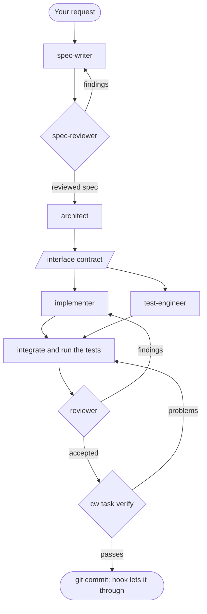

# agent-workflows

An engineering workflow for Claude Code and Codex that takes a change from spec
to a reviewed, tested and verified commit.

[](https://github.com/belevtsev/agent-workflows/actions/workflows/ci.yml)
[](LICENSE)
[](https://github.com/belevtsev/agent-workflows/releases/latest)

Coding agents often ship code that nobody reviewed, that has no tests, or that
is tested by the agent that wrote it. This project splits a substantial change
across agents with separate contexts: one writes the spec, one designs, one
implements, another writes tests from the contract without seeing the code, and
another reviews. The `cw` command records each step, and on Claude Code a hook
blocks the commit until `cw task verify` passes.

## How it works



The full flow is for substantial tasks: at least two of more than one package or
component changed, behaviour that must match across platforms or shells, more
than about 300 changed lines, or a design choice with real alternatives. Smaller
changes stay lightweight. The spec steps are skipped when a reviewed spec exists
or the request already states every behaviour with its values.

| Agent | Gets | Produces | Claude Code model |
| --- | --- | --- | --- |
| spec-writer | source documents, the repository | an [OpenSpec](https://github.com/Fission-AI/OpenSpec) change folder, a change log | Opus 5.5, high |
| spec-reviewer | the change folder and its sources, not the writer's reasoning | severity-graded findings | Opus 5.5, high |
| architect | the reviewed spec or request | design, interface contract, implementation brief | Opus 5.5, xhigh |
| implementer | the brief and the contract | the change, a self-review | Opus 5.5, high |
| test-engineer | the contract and interface, never the code | test matrix, tests, requirement map | Opus 5.5, high |
| reviewer | the integrated source, a reviewer bundle | findings with evidence and severity | Opus 5.5, high |

Codex uses [model-policy.yaml](skills/task-orchestration/model-policy.yaml).
See [agents](docs/agents.md) and the
[role contracts](skills/task-orchestration/references/contracts/README.md).

## Quick start

Install `cw`, which records tasks and runs checks (Go 1.27 or newer). Use
`@main`, not `@latest`, or a [release archive](docs/operations.md#get-cw):

```sh
go install github.com/belevtsev/agent-workflows/cmd/cw@main
```

**Claude Code.** Add the marketplace:

```sh
claude plugin marketplace add belevtsev/agent-workflows
```

Install the plugin, then start a new session:

```sh
claude plugin install agent-workflows@agent-workflows
```

**Codex.** Add the marketplace:

```sh
codex plugin marketplace add belevtsev/agent-workflows
```

Then run `codex`, open `/plugins`, install `agent-workflows` and start a new
session. For the `AGENTS.md` instruction block, use `cw install --host codex`
instead ([details](docs/operations.md#codex-install-and-uninstall)).

Check that `cw` can read your repository:

```sh
cw doctor --summary --repo "$PWD"
```

## Your first task

You ask, answer questions and approve the commit. The agent runs the rest,
including the `cw` commands below; you can run them yourself to inspect a task.

1. Ask for the change in your repository. Naming the skill starts the workflow;
   a plain request also works, because the skill loads when the task matches.

   ```text
   /agent-workflows:task-orchestration Add a --json flag to the export command
   ```

2. The agent runs `cw doctor`, decides whether the task is substantial and
   records the requirements and the checks that prove them
   ([plan format](skills/task-orchestration/references/global-workflow.md#start-and-bind-a-task)):

   ```sh
   cw task start --repo /absolute/path/to/repo --plan plan.json --summary
   ```

3. The spec writer and spec reviewer produce a change under
   `openspec/changes/`. The agent brings you the open questions.
4. The architect fixes the interface contract. The implementer and the test
   engineer work in parallel, isolated from each other.
5. Checks run through `cw`, so the record holds the real result:

   ```sh
   cw task run --task <task-dir> --check unit --summary
   ```

6. An independent reviewer reviews the change, then the agent runs the gate:

   ```sh
   cw task verify --task <task-dir> --summary
   ```

7. You approve the commit. It goes through once verify passes on the current
   source.

## The verify gate

On Claude Code the plugin checks every `git commit` and `git push` it can find
in a Bash command, in any form. Each open substantial task for the repository
(not abandoned, touched in the last 14 days) blocks it until `cw task verify`
passes on the current source. Editing a verified file reopens the task. With no
task at all, a large change gets a prompt suggesting `cw task start`.

In a Go module, verify also needs a passed direct `go test` run covering each
changed package, with allowlisted flags only (no `-run` or `-skip`); see
[evidence rules](skills/task-orchestration/references/global-workflow.md#start-and-bind-a-task).

**See why a commit is blocked.** The denial names each blocking task. This lists
its problems, such as a missing review or an unmet requirement:

```sh
cw task verify --task <task-dir> --summary
```

**Give a task up** so it stops blocking:

```sh
cw task abandon --task <task-dir> --reason "replaced by a new task"
```

**Turn the gate off.** Set the plugin option `enforce_verify` to `false`
(and `small_task_prompt` to `false` for the prompt), then restart Claude Code:

```sh
echo '{"enforce_verify":"false"}' | claude plugin configure agent-workflows@agent-workflows --values-stdin
```

The gate fails open: without `cw` on `PATH`, or on an internal error, the
command goes ahead. Codex has no hook; there the skill claims completion only
after verify passes. Details: [hooks](docs/hooks.md).

## Language packs

Core skills are language-neutral; language practice comes from opt-in packs.
Go is first: today the `cc-skills-golang` plugin in the same marketplace, plus a
few Go skills in core. On Codex, install it from `/plugins`; on Claude Code:

```sh
claude plugin install cc-skills-golang@agent-workflows
```

Coming: the Go pack as its own plugin with `cw lang`, then a UI pack. See the
[design](docs/design/language-packs.md).

## Skills

`task-orchestration` runs substantial changes and `code-review` reviews diffs;
the rest are specialists those two point to. Most load when a task matches;
some run only by name. See the [skill catalog](skills/README.md).

## Configuration

Paths, state, config and the model policy lookup: [operations](docs/operations.md).

## Advisers (optional)

`cw consult` can ask hosted advisers at decision checkpoints; the coordinator
decides from source evidence. See [advisers](docs/advisers.md).

## Upgrading from v2

Run `cw migrate-v2 --dry-run`, then `cw migrate-v2`, then install the plugins.
See [moving from v2](docs/operations.md#moving-from-v2).

## Contributing, security, license

See [CONTRIBUTING](CONTRIBUTING.md) and the [docs index](docs/README.md).
Report vulnerabilities as described in [SECURITY](SECURITY.md). Licensed under
the [MIT License](LICENSE).
