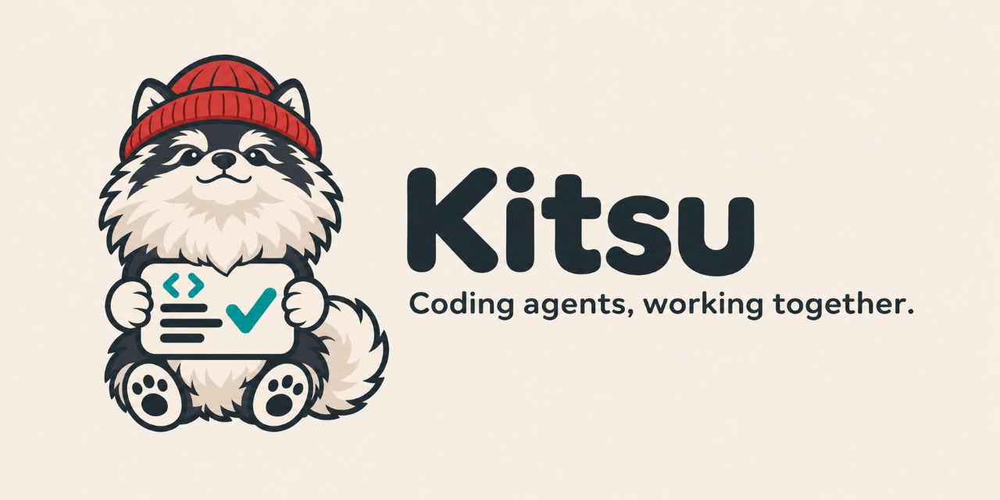

<div align="center">

# Kitsu



**Coding agents, working together.**

A workflow toolkit for coordinating coding agents through specification, implementation, testing, and review.
Seven specialist roles, shared task records, and token reporting, with a Git gate to check work before commits and pushes.

[](https://github.com/belevtsev/kitsu/actions/workflows/ci.yml)
[](LICENSE)
[](#install)

[The roles](#the-roles) · [Quick start](#quick-start) · [Install](#install) ·
[For a coding agent](#for-a-coding-agent) · [The Git gate](#how-the-gate-decides) · [State](#state) · [Documents](#documents)

</div>

| Part | What it does |
| --- | --- |
| **Agent coordination** | A coordinator in your coding-agent host delegates work to seven specialist roles, with a defined order, review handoffs, model choices, and limits on what each role may change. |
| **Shared task records** | Requirements, design decisions, tasks, tests, and review findings give the agents a common record to work from. `kitsu change` checks that record and reports the task's stage. |
| **Token reporting** | `kitsu tokens` reports recorded token usage by task and role, including the coordination overhead. |
| **Git gate** | As a supporting check, Git hooks allow commits and pushes only when the checks declared in `kitsu.toml` have passing evidence for that content. |

Your agent host runs the coordinator and delegates to the roles. Kitsu supplies the workflow instructions,
role definitions, record checks, and usage reports. The Git gate supports that workflow and can also be used on its own.

> [!IMPORTANT]
> This is a pre-release, and **nothing here is measured to improve anything**. [State](#state) says what was tried
> and what was not.

## The roles


A task that needs a requirement written or changed takes the full path: specification, design, tests, code, review
and commit. A task whose intended behaviour is already clear and does not change starts at the tests. You approve
the specification and the design, and the commit goes through the gate.

| Role | Its job | It may change |
| --- | --- | --- |
| `lookup` | Finds files, facts and existing specifications, and reports where they are. | nothing |
| `spec-writer` | Writes the requirements and their scenarios from the request and its sources. | `proposal.md` and `specs/` of the task's change folder |
| `architect` | Designs the building blocks, their dependencies and the tasks. | `design.md` and `tasks.md` of the task's change folder |
| `quality-engineer` | Writes the tests of the scenarios before the code exists. | the test paths, and `tests.md` of the task's change folder |
| `developer` | Writes the code that makes the tests pass, within the design. | any other path except `kitsu.toml`, `kitsu-roles.toml` and `openspec/`; it may add a test, and may not change or remove one |
| `reviewer` | Reviews a specification, a design or code that another role wrote, and reports findings. | nothing |
| `git` | Runs the checks and makes the commit through the gate. | nothing |

`kitsu roles` prints the seven roles, each with its model, its effort and what it may write. A repository changes the
models in `kitsu-roles.toml`. The texts name no language and no build tool; the commands of a repository come from its
`kitsu.toml`.

- [Roles](docs/roles.md): what each role does and may change.
- [The task workflow](docs/workflow.md): the two paths, the record of a task under `openspec/changes/<task>/`, and
  what `kitsu change` checks.
- [Tokens](docs/tokens.md): what is counted, and what "workflow tokens" mean.

Whether seven roles give better code than one agent working alone is **not measured**. The roles cost tokens that
one agent would not spend, and `kitsu tokens` shows how many. [The evaluation](docs/evaluation.md) says how the
comparison is to be made; it has not been run. A first run on two small tasks is in
[benchmarks](docs/benchmarks.md): it shows what the roles cost there, not whether the code is better.

## Quick start

1. [Install](#install) the CLI and [add the plugin](#for-a-coding-agent) to your coding-agent host.
2. Give the `task` skill a coding task. On Claude Code, invoke `/kitsu:task`; on Codex, use the installed `task` skill.
   The coordinator chooses the workflow, sets up the repository's checks and role paths, and delegates each stage.
3. Review the proposed specification and design when the task changes behavior, then follow implementation,
   tests, and review through the shared task record.

You can inspect the role instructions and a recorded task from the terminal:

```sh
kitsu roles
kitsu roles text coordinator
kitsu change status <task>
kitsu tokens --task <task>
```

The [task workflow](docs/workflow.md) explains the full path and the shorter path for work whose behavior is already clear.
Task records and token totals appear as the workflow runs; the commands above do not launch agents themselves.

### Add the supporting Git gate

In a repository of yours, once `kitsu` is installed:

```sh
kitsu init                          # creates kitsu.toml, installs three git hooks
kitsu add test -- <your test command>
kitsu run                           # runs the checks and records the result
git add -A
git commit -m "..."              # allowed: the content has a passing run
```

Change a file and commit again without `kitsu run`, and the commit is denied. The message names the check that has no
passing run and the command to run:

```text
kitsu: this commit is denied: its content has no recorded passing run of every declared check.
  test: not run on this content
kitsu: to produce the missing evidence, run:
  kitsu run
```

The [quick start](docs/quickstart.md) is the same five commands as a text that a test executes.

## Install

Install the CLI from release artifacts, without cloning this repository or installing Go.
On macOS or Linux:

```sh
curl -fsSL https://raw.githubusercontent.com/belevtsev/kitsu/main/install.sh | sh
```

On Windows, in PowerShell:

```powershell
irm https://raw.githubusercontent.com/belevtsev/kitsu/main/install.ps1 | iex
```

**Prepared for `v3.0.0-beta.2`, which is not published yet.** The commands above need the
corresponding release assets. To try this build now, [install the CI artifact](docs/release-install.md#install-a-ci-artifact-before-publication)
with the same scripts; that also needs no clone or Go. The old `v3.0.0-beta.1` release contains `cw`.

The installer selects your platform and architecture, verifies the archive checksum before
replacing the executable, and sets up your user `PATH`. The default location is `$HOME/.local/bin`
on macOS/Linux or `%LOCALAPPDATA%\kitsu` on Windows. Open a new terminal, then run `kitsu version`.

Rerun the installer command to reinstall or update to its current default version. The
[installation guide](docs/release-install.md) covers version pinning, custom directories, opting
out of `PATH` changes, and manual archive installation. Contributors can [build from source](docs/development.md#build-from-source).

Kitsu uses Git to work in a repository. On Windows its Git hooks use the `sh` supplied by Git for
Windows. The installer installs only Kitsu's CLI; [add the plugin](#for-a-coding-agent) through
your host's marketplace to use the coordinated workflow.

The hooks look for `kitsu` only in the entries of `PATH` that are absolute paths; see
[hooks](docs/hooks.md#when-kitsu-is-not-on-path). Existing `cw` users should follow the
[migration guide](docs/migration.md) before initializing Kitsu in an existing repository.

## For a coding agent

The plugin's `task` skill gives the coding-agent host a coordinator workflow for specification, design, tests,
implementation, review, and commit. Claude Code receives the seven roles as agents; on Codex, the coordinator uses
the texts printed by `kitsu roles text <role>`. Execution and delegation are handled by the host.

The plugin also connects the workflow to supporting checks and token reporting:

| It adds | What that does |
| --- | --- |
| Context | It tells a new session which repository checks support the workflow. |
| A guard | It stops a git call that skips the hooks, such as `git commit --no-verify` or `git commit -n`, a `kitsu` call that turns the gate off, and an edit of `kitsu.toml`, a hook file, the git configuration or a record of `kitsu`. |
| Token notices | It gives `kitsu tokens record` the notices that a role or the session has ended. |

Claude Code asks you before a call that the guard stops. Codex refuses it and gives the reason, because Codex cannot
ask from a hook; run the call yourself if you want it. The guard is a reminder, not a wall:
[operations](docs/operations.md#what-it-misses) lists what it misses.

The additional [`kitsu`](skills/kitsu/SKILL.md) skill explains the check-and-change loop, each gate denial,
and seven worked examples that tests replay against the CLI. The role workflow has not been run on Codex.

On Claude Code:

```text
/plugin install kitsu --marketplace belevtsev/kitsu
```

On Codex:

```sh
codex plugin marketplace add belevtsev/kitsu
codex plugin add kitsu@kitsu
```

Codex does not run the hooks of a plugin when it installs it. Its documentation says:
"Installing or enabling a plugin doesn't automatically trust its hooks … Codex skips
them until the user reviews and trusts the current hook definition." Until you review and trust them, the session
gets no text from `kitsu context`, no guard and no token records. The git hooks still decide.

## How the gate decides


1. **`kitsu run` makes the evidence.** It runs each check of `kitsu.toml` that has no passing run on the working tree as
   it is on disk, and records every run with that content.
2. **git asks.** `kitsu init` installed three hooks: `pre-commit`, `pre-merge-commit` and `pre-push`. Each one asks
   `kitsu hook` about the content that git is about to record or send: the commit at a commit, and the new tip of each
   branch or tag at a push. A hook runs no check and waits for none.
3. **`kitsu hook` decides from the records.** When every declared check has a recorded passing run on exactly that
   content, git goes on. Otherwise the commit or the push is denied, also when `kitsu hook` cannot tell, and the message
   names each check that is not satisfied, or the cause.

The picture shows the gate in enforce mode, as `kitsu init` sets it. After `kitsu init --observe` the hooks record what
they would decide and allow every commit and push; see [observe mode](docs/hooks.md#observe-mode). At a push, a ref
is allowed without a judgement when the push deletes it, when it holds notes, or when it adds nothing to what the
remote already holds; see [pre-push](docs/hooks.md#pre-push).

[Hooks](docs/hooks.md) says what each hook judges, [evidence](docs/evidence.md) what a recorded passing run proves
and what it does not, and [operations](docs/operations.md) lists every command and every exit status.

The workflow, token reports, and gate share the same CLI:


## State

- Kitsu `v3.0.0-beta.2` is prepared but unpublished. The earlier
  [`cw v3.0.0-beta.1`](https://github.com/belevtsev/kitsu/releases/tag/v3.0.0-beta.1)
  was published on 15 November 2026. Its installation was checked on Linux, macOS and Windows.
  CI builds the six Kitsu archives and tests the [prepared release instructions](docs/release-install.md).
- **Nothing here is measured to improve anything.** The gate has not yet been used on real work. The plugin and the
  roles ran with a model in scratch repositories only, on two small tasks: [benchmarks](docs/benchmarks.md) says what
  that showed and what it cost. The [production plan](openspec/production-plan.md) says what was built and how each
  part was checked.
- The rename was developed on Linux. CI is configured to test Linux, macOS and Windows;
  the historical cross-platform results above describe `cw`, not an executed Kitsu release.

## Known limits

- `git commit --no-verify` and `git push --no-verify` skip the hooks. So does a clone in which nobody ran `kitsu init`.
  A check in continuous integration, `kitsu run --base <rev>`, is the backstop.
- A passing run proves that the check passed on that content on that machine. It proves nothing about what the check
  does not test.
- The hooks judge what git is about to record. They do not run the checks: `kitsu run` does, before the commit.
- `kitsu` reads the records of Claude Code and Codex to count tokens. Their format is not documented by either host, so
  a count can be `unknown`.

More in [evidence](docs/evidence.md) and [hooks](docs/hooks.md).

## Documents

| Document | What it holds |
| --- | --- |
| [Quick start](docs/quickstart.md) | The five commands in a new repository. A test executes them. |
| [Try it](docs/try-it.md) | Everything that can be tried by hand, with the output to expect, and what was never run. |
| [Operations](docs/operations.md) | Every command, `kitsu.toml`, the exit statuses and where `kitsu` keeps its records. |
| [Hooks](docs/hooks.md) | The three git hooks, a hook shared with another tool, the plugin's hooks, and the known limits. |
| [Evidence](docs/evidence.md) | What a recorded passing run is, what it proves and what it does not. |
| [Roles](docs/roles.md) | The seven roles, their models, what each may write, and `kitsu-roles.toml`. |
| [The task workflow](docs/workflow.md) | The two paths of a task, its record under `openspec/changes/<task>/`, and `kitsu change`. |
| [Tokens](docs/tokens.md) | What `kitsu tokens` counts, what "workflow tokens" are, and when a count is unknown. |
| [Benchmarks](docs/benchmarks.md) | What `kitsu` costs: the time of a commit and of each command, and the tokens of an agent on two small tasks. |
| [Evaluation](docs/evaluation.md) | The cases only a model run can show, and the comparison with one agent. No case was run; one first trial of the skill `kitsu` is recorded. |

[docs/README.md](docs/README.md) lists every document, and [CONTRIBUTING.md](CONTRIBUTING.md) says how to change
this repository.

## The previous workflow

Versions up to 2.0.96 were a larger workflow of skills and task records. It is kept on the branch `workflow-v3`.

## License

MIT, see [LICENSE](LICENSE). Third-party code: [THIRD_PARTY.md](THIRD_PARTY.md).
