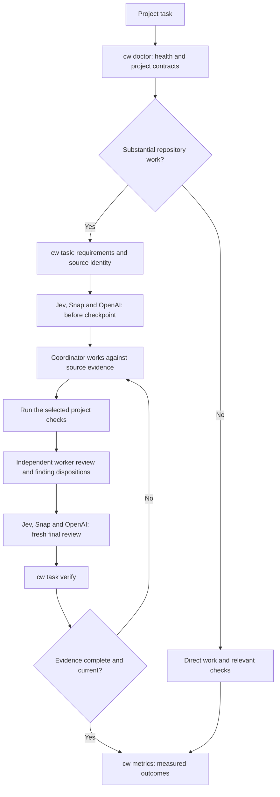
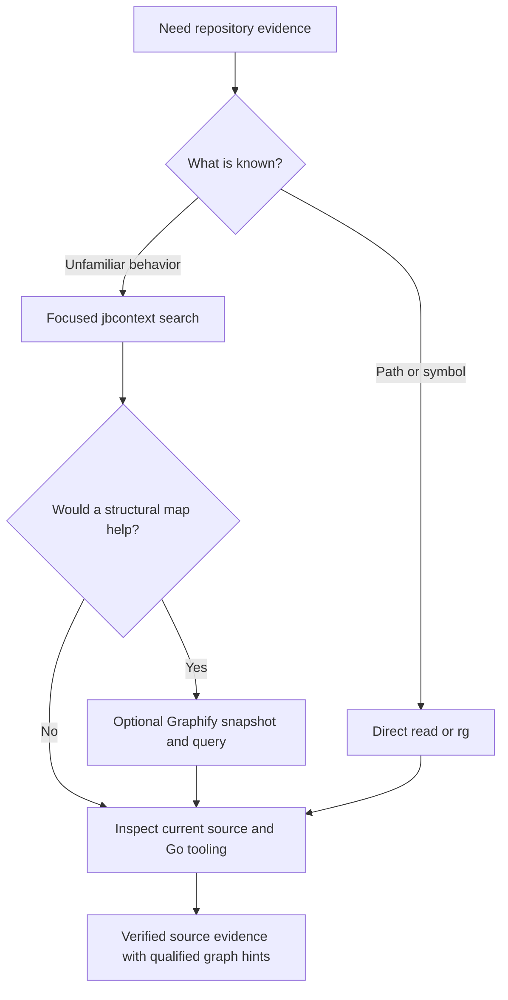

# agent-workflows

A Go skill manager for personal agent workflows on macOS and Linux. Install
editable skills, model policy, and shared instructions for Codex, Claude Code, or
both, as verified, immutable snapshots. Updates are manual and reversible.

This guide covers the [current release](https://github.com/belevtsev/agent-workflows/releases/latest).

## Install

```sh
git clone https://github.com/belevtsev/agent-workflows.git
cd agent-workflows
./install.sh --host claude
```

Use `--host codex`, `--host claude`, or `--host all`. Without `--host`, install
uses the host it can detect, and stops to ask if it finds both or neither.

You need Git, `curl`, `tar`, and `sha256sum` or macOS `shasum`, plus the host you
are installing for. Release binaries support macOS/Linux on ARM64 and AMD64 and
need no Go installation. Building an unreleased revision requires the Go version in
[go.mod](go.mod).

Installation registers 33 skills with 78 entrypoints on each selected host, and
adds the same managed instructions to both:

| | Codex | Claude Code |
| --- | --- | --- |
| Skills | `~/.agents/skills/<name>` | `~/.claude/skills/<name>` |
| Instructions | Managed block in `$CODEX_HOME/AGENTS.md` | Managed block in `~/.claude/CLAUDE.md` |
| Settings | `model`, `model_reasoning_effort` and five memory keys in `config.toml` | `model` and `effortLevel` in `settings.json` |
| Custom location | `--codex-home` or `CODEX_HOME` | `--claude-home` or `CLAUDE_CONFIG_DIR` |

The Claude Code defaults come from the coordinator profile in
[model-policy.claude.yaml](skills/task-orchestration/model-policy.claude.yaml):

```json
{
  "model": "claude-opus-5-5",
  "effortLevel": "xhigh"
}
```

The Codex defaults come from
[model-policy.yaml](skills/task-orchestration/model-policy.yaml) and
[global/codex-defaults.toml](global/codex-defaults.toml):

```toml
model = "gpt-6.1-sol"
model_reasoning_effort = "max"

[features]
memories = true

[memories]
generate_memories = true
use_memories = true
extract_model = "gpt-6.1-sol"
consolidation_model = "gpt-6.1-sol"
```

Unrelated settings, permissions and local content are preserved on both hosts.
`settings.json` edits change only those two keys and keep every other byte. If you
or Claude Code later change one of them, it stays yours: `cw status` reports it as
`settings_drift`, and update, rollback and uninstall leave it alone. Each device
keeps its own configuration. In `config.toml`, use ordinary TOML tables or dotted
keys for the shared settings; inline `features` or `memories` tables must be
converted before installation.

Under Claude Code, your `code-review` skill replaces the bundled `/code-review`.
The `/review` alias still runs the bundled one.

Setup links `~/.local/bin/cw` directly to the installed binary and adds a managed
PATH entry to your Bash/zsh startup file when needed. Open a new terminal, then:

```sh
cw version
cw status
cw validate
```

Keep the checkout for installation and updates. The installed command works from
any directory; status, rollback, recovery, and uninstall use installed records
and snapshots. Manager version and active skill revision are reported separately.
Use `./install.sh --dry-run` to preview installation without downloading, building,
or changing persistent state. See [operations](docs/operations.md) for custom
paths, shell selection, and recovery.

### Add or remove a host

Run install again with another host. It adds that host to the same installation
without changing the active release:

```sh
./install.sh --host codex
```

The host comes from the installed release, not your checkout, so this also works
after a rollback or with uncommitted changes. To move to the checkout's HEAD
afterwards, run `./install.sh` again without `--host`.

To drop one host and keep the other:

```sh
cw uninstall --host codex
```

If that host's files are already gone, add `--forget` so the record is removed
without restoring anything:

```sh
cw uninstall --host codex --forget
```

### Upgrading from v1

The v2 manager uses new paths and doesn't read a v1 installation, and a v1
`cw update` refuses this source without changing anything. Before you start, note
the `state_dir` that `cw status` reports. Then, using your existing `cw`:

```sh
cw uninstall
```

Clone or update this repository, and install:

```sh
./install.sh --host all --adopt-personal-skills
```

Uninstall restores your own files and adopted skills, and
`--adopt-personal-skills` moves those skills back under management. Rollback
history from v1 doesn't carry over. Once you have verified the new installation,
delete the old `state_dir` and the old adviser Python environment. Task records stay
where they were, and `--store` reads them.

## Current model policy

Codex and Claude Code keep separate roles, and the rest of the policy is shared.

| Role | Codex | Claude Code |
| --- | --- | --- |
| Coordination, substantive work, review, and final verification | `gpt-6.1-sol` at `max` | `claude-opus-5-5` at `xhigh` |
| Bounded routine execution | `gpt-6-luna` at `xhigh` | `claude-opus-5-5` at `xhigh` |
| Bounded evidence gathering | `gpt-6-luna` at `high` | `claude-opus-5-5` at `high` |

Three independent advisers are required on both hosts:

| Adviser | Model | Reasoning effort |
| --- | --- | --- |
| TypeSafe | `jev-1.14.0` | Provider managed |
| SubQ | `subq-snap-preview` | Provider managed |
| OpenAI Decisions | `gpt-6-luna` | Decisions API managed |

The editable [Codex policy](skills/task-orchestration/model-policy.yaml) and
[Claude Code policy](skills/task-orchestration/model-policy.claude.yaml) define
dispatch roles. [Host mapping](skills/task-orchestration/references/hosts.md) covers
what differs in practice. The coordinator checks actual runtime model metadata; a
saved policy does not switch an existing chat or prove account availability. It
makes the final decision from source evidence and verification after considering
all three required advisers at equal standing.

`settings.json` rejects `max`, so `xhigh` is the highest persisted Claude Code
effort. Use `/effort max` for a session.

## Included skills

| Registration | Purpose |
| --- | --- |
| task-orchestration | Coordinate substantial work, models, assumptions, and evidence |
| production-plan | Build context-grounded implementation plans with independent design challenges |
| code-review | Review correctness and compatibility risks |
| go-principal-engineer | Resolve production Go ownership and lifecycle decisions |
| software-architecture | Assess boundaries and interface evolution |
| codebase-design | Design deep modules with small interfaces and real seams |
| domain-modeling | Sharpen domain language and record hard-to-reverse decisions |
| parse-dont-validate | Turn repeated checks into types parsed at the boundary |
| expand-contract | Plan zero-downtime schema, API, and event changes |
| isolation-anomalies | Find write skew and lost updates in transactions |
| retry-amplification | Prevent retry storms and failures that outlive their cause |
| clocks-and-time | Avoid wall-clock, skew, time zone, and DST bugs |
| test-strategy | Choose verification for changed behavior |
| security-threat-model | Build a repository-grounded threat model |
| backend-security-review | Scope backend security checks and verify findings against reachable paths |
| protobuf-contracts | Review binary, generated API, and ProtoJSON evolution and peer compatibility |
| go-pki-mtls | Review reusable certificate, trust, and service identity lifecycles |
| cc-skills-golang | Go specialist skills |
| db-postgres | Diagnose PostgreSQL against actual evidence |
| archify | Render portable, inspectable architecture and workflow diagrams |
| graphify | Explore tracked Go source with a local structural graph |
| typesafe-ai | Use TypeSafe and Jev for scoped judgments |
| docker-agent-config | Author Docker Agent configuration |
| docker-agent-deploy | Expose Docker Agents through the requested server interface |
| docker-agent-run | Run Docker Agents with the appropriate execution mode |
| docker-build-strategies | Create and improve Dockerfiles |
| docker-compose-patterns | Configure and diagnose Docker Compose |
| docker-destructive-guardrails | Check authorization and scope before destructive Docker actions |
| docker-project-foundations | Establish Docker project configuration |
| docker-sandboxes-env | Author declarative sandbox environments |
| docker-sandboxes-kits | Package and validate sandbox kits |
| docker-sandboxes-lifecycle | Manage sandbox creation, execution, and removal |
| docker-sandboxes-network-credentials | Configure sandbox networking and credential access |


See [third-party notices](THIRD_PARTY.md). Skills keep their own optional
dependencies. Archify requires Node.js 18+ and Chrome/Chromium for browser checks;
Graphify needs a separately provisioned `graphify` executable from the pinned
`graphifyy==0.9.91` Python package; Docker skills require the corresponding Docker
tools and platform support.
`cw status` reports detected executables in `skill_prerequisites`; each skill
checks versions, access, and subcommands when used. The manager does not install
optional tools.

Use a natural request or invoke a skill explicitly. Claude Code uses `/name`, and
Codex uses `$name`:

```text
/production-plan Plan this change against the current repository contracts.
/code-review Review this diff for concrete correctness and compatibility defects.
/task-orchestration Implement this workflow, consult Jev, Snap and OpenAI Decisions at both checkpoints, and verify the result.
```

## Global project workflow

The same installed workflow serves every project. `--repo` selects the target
workspace independently of the skill manager's enrolled source checkout. Project
instructions supply their own commands and constraints; tool capabilities determine
which discovery and checks apply.

```sh
cw doctor --repo /absolute/path/to/project
cw doctor --repo /absolute/path/to/project --live
cw task --help
cw metrics schema
```

`doctor` reports source identity, project capabilities, contract paths and tool
metadata. Explicit live checks distinguish actual local tool health from executable
presence. It does not provision dependencies, index projects, register watchers or
call hosted models. Go, Terraform, Roblox, Node and Python markers can coexist;
Graphify and gopls apply to supported Go work.

For substantial repository work, `cw task` retains requirements, actual check
results, worker assignments and handoffs, current-source references and both
source-bound adviser checkpoints in a private directory outside project source.
`cw task verify` checks evidence against the current worktree. New substantial-change
tasks also require an accepted independent worker review of the completed source
before final consultation.
Small and unchanged read-only tasks retain the lightweight path. The coordinator
verifies the meaning of the evidence and makes the final decision. The
[worker handoff guide](skills/task-orchestration/references/worker-handoffs.md)
describes the reusable contract; project instructions still select their own checks.

Interactive workflow diagrams:

- [Validated worker handoffs and independent review](docs/diagrams/validated-worker-handoffs.html)
  shows the current path for substantial changes with delegated workers, including
  coordinator acceptance, review findings and rework.
  [Editable source](docs/diagrams/validated-worker-handoffs.json).
- [Earlier workflow overview](docs/diagrams/workflow-overview.html) preserves the
  overview from before the worker handoff and independent review gates were added.
  [Editable source](docs/diagrams/workflow-overview.json).

Download an HTML file and open it in a browser; GitHub displays its source.
Each diagram is self-contained and cites a pinned source revision. The adjacent
JSON files retain the editable specifications. Local delivery and browser-check
receipts are excluded from version control.



`cw metrics` summarizes measured outcomes across projects and separates synthetic
acceptance, actual diagnostics and productivity observations. Missing usage or
quality values remain unknown. Comparable baseline/candidate cases can be compared;
source/environment differences and missing pairs remain visible. A fixture pilot
does not establish production quality or cost savings.

See the [global workflow command guide](skills/task-orchestration/references/global-workflow.md)
for task plans, source/phase contexts, check execution, adviser attachment and
measurement inputs. Installation activates these shared instructions and commands;
it does not rewrite project-specific instructions.

## Optional Graphify discovery

Use [Graphify](skills/graphify/SKILL.md) when a structural map of tracked Go
packages and symbols helps narrow an investigation. Keep direct reads and `rg`
for known paths or symbols, and use focused `jbcontext search` for unfamiliar
behavior when available. Graphify is an optional branch of that discovery:



The guarded helper uses local code-only extraction, disables LLM deduplication,
auto-refresh and query logging, and keeps caches outside the repository and
immutable release. Queries refuse stale or incomplete snapshots. Graph edges,
including `EXTRACTED` and `INFERRED` relationships, are qualified discovery hints; inspect source and use
`gopls` as needed to establish callers, interface targets, and runtime wiring.
See [runtime setup and commands](docs/operations.md#optional-graphify-runtime).
`cw install`, update and status do not provision Graphify or build its cache.

Substantial work still requires all three advisers before implementation and at
final review. The coordinator decides from verified evidence and current checks.

Repository commands, product details, and operational constraints belong in the
owning repository's instructions and docs. Skill selection does not grant
permission for publication, credential changes, or infrastructure operations.

## Set up Jev

Jev is hosted by TypeSafe. Obtain a key from the official
[TypeSafe Console](https://console.typesafe.ai/keys) and store it in your local
secret manager. Installation and offline validation work without service keys.
Never paste a key into chat or commit it.

For a temporary terminal session, enter the key using the masked prompt for
your shell. Keep tracing disabled.

Bash:

```bash
set +x
IFS= read -r -s -p 'TypeSafe API key: ' TYPESAFE_API_KEY
printf '\n'
export TYPESAFE_API_KEY
```

zsh:

```zsh
set +x
read -r -s 'TYPESAFE_API_KEY?TypeSafe API key: '
printf '\n'
export TYPESAFE_API_KEY
```

The installed [TypeSafe skill](third_party/typesafe-ai/SKILL.md) and its
[development consultation guide](third_party/typesafe-ai/references/development-consultations.md)
describe the API contract. The workflow uses the pinned `jev-1.14.0` model.

The explicit version keeps adviser results comparable when TypeSafe changes its
moving aliases. As checked on 16 October 2026, the official
[model reference](https://docs.typesafe.ai/models) maps `jev-latest` to
`jev-1.13.0` and `jev-preview` to `jev-1.14.0`. Those mappings can change;
neither alias replaces this workflow's pin. The linked
[1.13 limitations](https://docs.typesafe.ai/model-jaggedness/jev-1.13) describe
that version, rather than a verified list of 1.14 limitations.

The [Jev 1.14 announcement](https://typesafe.ai/blog/jev-1-14) also describes
opt-in capabilities. [Images](https://docs.typesafe.ai/images) and
[bounding-box answers](https://docs.typesafe.ai/primitives/box) require
`TypeSafe-Danger-Zone-Images: true` and are experimental. The optional
`TypeSafe-Danger-Zone-Long-Context: true` header raises Jev's normal 64k-token
request and 32k-token per-question limits to 262k for both. The shared adviser
helper sends neither header: it retains the same text and Choice questions for
all three providers. These features are separate from using the 1.14 model.

## Set up SubQ Snap

Obtain a separate key from the official [SubQ API Console](https://console.subq.ai/)
using its [authentication guide](https://docs.subq.ai/using-the-api/authentication/).
Store it outside the source tree in your local secret manager. Snap uses
`SUBQ_API_KEY`; Jev uses `TYPESAFE_API_KEY`.

Bash:

```bash
set +x
IFS= read -r -s -p 'SubQ API key: ' SUBQ_API_KEY
printf '\n'
export SUBQ_API_KEY
```

zsh:

```zsh
set +x
read -r -s 'SUBQ_API_KEY?SubQ API key: '
printf '\n'
export SUBQ_API_KEY
```

Run `cw status` to check `jev_credential_present` and `subq_credential_present`.
These are offline booleans for that process; they do not validate keys or prove
availability in another process. Start the CLI from the same terminal to inherit
the exported keys:

```sh
claude
```

```sh
codex
```

Desktop apps start from your login session, not your shell profile. Supply both
variables through your local secret manager or the app's launch environment. On
macOS, after setting both variables in the terminal, a session-only option is:

```sh
set +x
launchctl setenv TYPESAFE_API_KEY "$TYPESAFE_API_KEY"
launchctl setenv SUBQ_API_KEY "$SUBQ_API_KEY"
```

Fully quit and relaunch the app, then open a fresh session and verify key presence
without displaying values. This launch environment applies to subsequently
started GUI processes in the current login session; it is not persistent secret
storage. Existing processes retain their startup environment.

Snap's documented model is [`subq-snap-preview`](https://docs.subq.ai/using-the-api/models/),
a public preview alias. Records retain the requested and returned model IDs.
SubQ [retains request data indefinitely by default](https://docs.subq.ai/using-the-api/data-retention/);
organization-level zero data retention is available for Decisions. Confirm
permitted sharing and retention before sending source evidence to a provider.

## Set up OpenAI Decisions

Obtain an API key from the [OpenAI Platform](https://platform.openai.com/api-keys)
and store it in your local secret manager. The required adviser uses
[`gpt-6-luna` through the Decisions API](https://developers.openai.com/api/docs/guides/decisions).
This API call is separate from dispatching a Luna worker with a reasoning profile.

Enter the key with the masked prompt for your shell:

Bash:

```bash
set +x
IFS= read -r -s -p 'OpenAI API key: ' OPENAI_API_KEY
printf '\n'
export OPENAI_API_KEY
```

zsh:

```zsh
set +x
read -r -s 'OPENAI_API_KEY?OpenAI API key: '
printf '\n'
export OPENAI_API_KEY
```

Supply `OPENAI_API_KEY` alongside `TYPESAFE_API_KEY` and `SUBQ_API_KEY`.
The installed workflow requires all three advisers on every consultation request.
A missing key records unavailable coverage and preserves the other advisers'
results. The helper rejects attempts to exclude required OpenAI advice.

`cw status` reports `openai_credential_present` as an offline boolean for its own
process. For a macOS desktop app, set the launch environment from the configured
terminal:

```sh
set +x
launchctl setenv OPENAI_API_KEY "$OPENAI_API_KEY"
```

Use a fresh app process and session to inherit that environment and updated skill
instructions. Keep request content within the task's permitted sharing and the
account's [OpenAI data controls](https://developers.openai.com/api/docs/guides/your-data).

## Consult advisers and let the coordinator decide

For substantial work, the coordinator consults Jev, Snap and OpenAI Decisions before implementation,
and again after integration and current checks, before completion or authorized
publication, within the task's permitted sharing. Tasks without implementation use the first checkpoint before
substantive drafting or review. Small edits and direct factual answers remain
lightweight.

Participating advisers receive the same permitted evidence, questions, and neutral
Choice options. The [consultation helper](skills/task-orchestration/references/consultation-helper.md)
uses one attempt per provider, a 30-second batch budget, and no automatic retries.
It validates each response independently and records unavailable coverage. The
coordinator records sharing restrictions, checks advice against exact sources
and tests, records reasons for rejecting differing advice, and leaves missing
material facts unresolved.
Confidence and voting do not choose the result.

See the [decision diagrams](docs/decision-flow.md) for the task checkpoints,
the three adviser branches, disagreement and missing coverage, and the
coordinator's resolved/unresolved decisions.

Prepare a request containing `{state,
questions}` as described in the [helper contract](skills/task-orchestration/references/consultation-helper.md).
Keep credentials outside requests, records, and shared evidence. The following
commands use different output paths because the helper refuses overwrites:

```sh
cw consult --request /path/to/request.json --output /path/to/preview.json --dry-run
cw consult --request /path/to/request.json --output /path/to/advice.json
```

The dry run validates and writes a record without network access. A live call can
incur usage with participating providers. It records their independent results and leaves
`final_decision` pending. After checking the evidence, the coordinator writes a
decision and finalizes a separate record offline:

```sh
cw consult --adjudicate /path/to/advice.json --decision /path/to/decision.json --output /path/to/final.json
```

An unavailable or refusing provider preserves the other results while the
coordinator continues source verification and reports the coverage limit. A successful API response
proves access for that request; it does not prove judgment accuracy or
implementation correctness.

Every request uses the three required models. OpenAI refusals are recorded per
question, preserving other valid answers and identifying missing
coverage. They do not become choices against a claim.

To verify all three integrations from a fresh agent session, use:

```text
Use the installed task-orchestration workflow to check TYPESAFE_API_KEY and
SUBQ_API_KEY and OPENAI_API_KEY presence without showing values. Make one Choice
request using only synthetic public text, jev-1.14.0,
subq-snap-preview and OpenAI Decisions gpt-6-luna, with the
30-second batch budget and no retries. Validate requested and returned models
and report each provider's result or safe failure category. Compare the results
with the supplied evidence and record the coordinator's final decision. Never print keys
or authorization headers.
```

See [workflow and integrations](docs/workflow.md#typesafe-jev-and-subq-snap) for
policy details and source links.

### Evaluate multilingual judgments

The bundled [multilingual evaluation](skills/task-orchestration/references/consultation-helper.md#multilingual-evaluation)
uses 12 synthetic scenarios translated into English, Ukrainian and German.
Expected answers stay with the local scorer. Each adviser is scored independently;
agreement and confidence do not choose the correct answer.

From the editable checkout, validate the corpus offline:

```sh
GOWORK=off go run ./cmd/cwdev eval multilingual
```

For an explicit hosted run, supply the three provider keys through the process
environment and choose a new private output directory outside repositories and
managed releases:

```sh
GOWORK=off go run ./cmd/cwdev eval multilingual --live --output-dir ~/.local/state/agent-workflows/audits/multilingual-baseline-01
```

The live run makes at most nine provider requests without retries and writes
`report.json`, `summary.md` and safe consultation records. Read accuracy together
with coverage and per-case errors. A valid `insufficient_evidence` judgment is an
answer; a refusal or unavailable provider is missing coverage. This small labeled
baseline measures performance on its frozen cases. It does not establish
calibration, production readiness or improvement over another model version.
Installation, source validation and CI never run the hosted evaluation.

## Maintain the installation

Installation and update require a clean committed checkout. Maintenance commands
return JSON on stdout and errors on stderr. Choose the command for your task:

| Command | Purpose |
| --- | --- |
| `cw status` | Inspect active/previous revisions, manager identity, registrations, owned settings, model profiles, and local credential presence |
| `cw validate` | Validate the source skill suite without activating it |
| `cw update --dry-run` | Preview local validation, ancestry, ownership, and registration changes without fetching or activating |
| `cw update` | Fetch and validate exact `origin/main`, prepare its verified binary, fast-forward the checkout, and activate the snapshot |
| `cw rollback --dry-run` | Preview restoration of the previous validated snapshot |
| `cw rollback` | Restore the previous snapshot and its owned settings using activation history |
| `cw recover --dry-run` | Inspect recovery of an interrupted managed transaction |
| `cw recover` | Reverse unfinished owned changes using the recovery journal |
| `cw uninstall --dry-run` | Preview removal of owned registrations and settings |
| `cw uninstall` | Remove managed links/blocks and restore original owned settings and adopted registrations |

The update preview is offline and cannot establish the current remote candidate.
Failed update preparation leaves the active installation unchanged. Rollback
restores skills and owned settings without rewinding Git or changing GitHub.
Recovery preserves unrelated edits and refuses modified owned content. Uninstall
preserves the checkout, caches, credentials, connectors, and consultation environment.
Use [operations](docs/operations.md) for detailed command and recovery contracts.

Start a fresh agent session after install, update, or rollback to load the active
instructions. Check `cw status` and `cw validate`, confirm the configured profiles
against the model table above, and inspect actual chat runtime metadata separately.
Authenticate GitHub, Jira, and Confluence on each device and verify the intended
identity with a permitted read.

See [development](docs/development.md) for native checks and releases.
