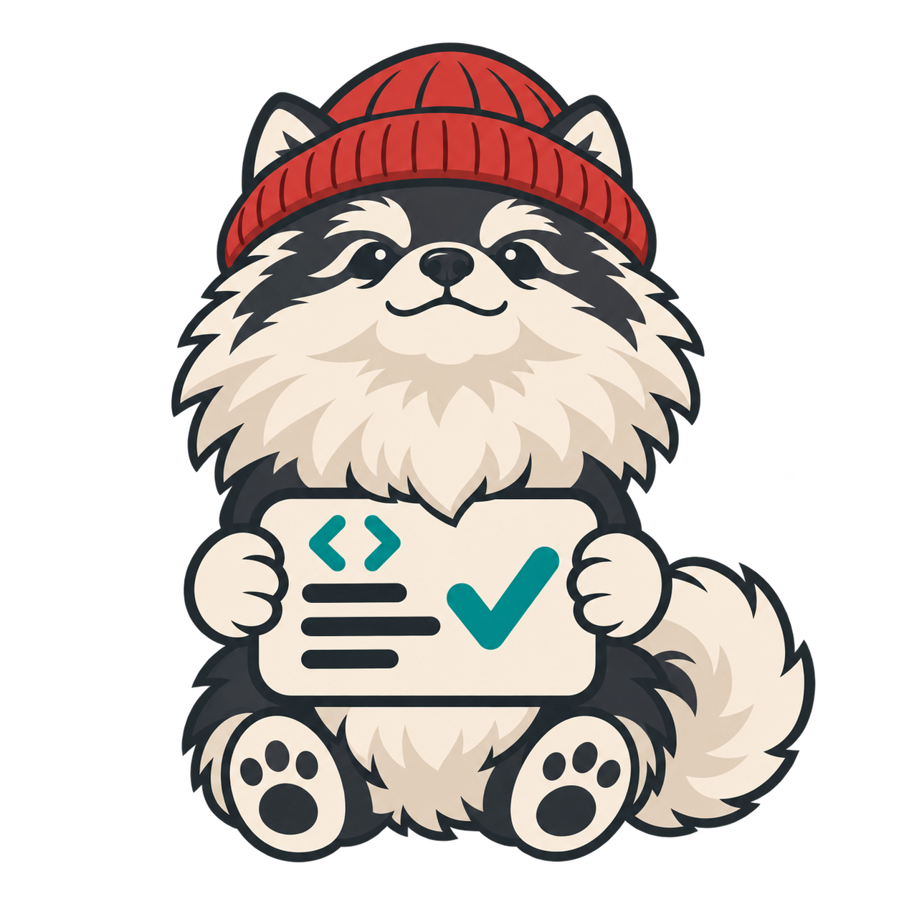

# Kitsu



Kitsu lets you start a coding task in **Codex** or **Claude Code** and pick it up in a fresh chat. Your agent uses the Kitsu CLI to save the request, findings, and check results in your Git worktree.

## Install

You need Git and the coding agent you use. Run the command for your platform once to install the CLI and register its matching plugin. For Claude Code, replace `codex` with `claude` in the install command.

**macOS or Linux**

```sh
curl -fsSL https://github.com/belevtsev/kitsu/releases/latest/download/install.sh | sh -s -- --host codex
```

**Windows PowerShell**

```powershell
& ([scriptblock]::Create([Net.WebClient]::new().DownloadString('https://github.com/belevtsev/kitsu/releases/latest/download/install.ps1'))) -AgentHost codex
```

If Kitsu doesn’t appear, restart your agent and run `kitsu agent check --host codex` or `kitsu agent check --host claude` in your project’s terminal. [Installation guide](docs/release-install.md)

## Quick start

Open a fresh chat in your project’s Git repository. Ask your agent for a test plan.

**Codex** — On first use, open `/hooks` to review and trust Kitsu’s hooks.

> Use Kitsu’s task skill to find how this repository runs its tests. Give me the command you found, one test worth adding, and the task ID. Stop after the plan.

**Claude Code**

> /kitsu:task Find how this repository runs its tests. Give me the command you found, one test worth adding, and the task ID. Stop after the plan.

Save the task ID from the reply. If the project has no test command yet, the proposed test can be your starting point.

### Resume later

Open a new chat in the **same Git worktree** and replace `<task-id>` with your saved ID.

- **Codex:** `Use Kitsu to resume task <task-id>. Show me the saved test plan and the next step.`
- **Claude Code:** `/kitsu:task Resume task <task-id>. Show me the saved test plan and the next step.`

Lost the ID? Ask your agent to list your saved Kitsu tasks.

<a name="the-roles"></a>

## Start at any stage

Use the prompt for your stage. For Design through Implementation, replace “Use Kitsu’s task skill.” with `/kitsu:task` in Claude Code.

### Bug fix

**Codex**

> Use Kitsu’s task skill to investigate the failing test. Reproduce the failure, explain the cause, and stop before editing. Give me the task ID.

**Claude Code**

> /kitsu:task Investigate the failing test. Reproduce the failure, explain the cause, and stop before editing. Give me the task ID.

When you’re ready for the fix, reply in either chat:

> Fix the cause, add a regression test, and verify the result. Leave the changes uncommitted.

### Design

> Use Kitsu’s task skill. Design a flag for choosing order export columns. Show example commands and expected output for default, selected, and unknown columns. Stop at the proposal.

### Architecture

> Use Kitsu’s task skill. We need to export a million orders with 256 MiB of memory. Compare a database cursor with bounded pages. Recommend an approach and explain how it handles cancellation.

### Review

> Use Kitsu’s task skill. Independently review my staged CSV export patch. Check default columns and partial files after errors. Report each defect with its location and a reproducing test. Stop after review.

### Implementation

> Use Kitsu’s task skill. Add `--columns id,total` to the order export. Preserve the specified order and existing defaults. Reject unknown columns before writing. Test all three cases through the CLI.

For ticket intake, verification, or delivery, use the same chat prefix:

| Starting point | Request |
| --- | --- |
| Ticket | Read the issue I linked. Summarize the expected behavior and what we still need to learn. Stop before editing. |
| Verification | Run the exporter on a field containing a comma. Check that the CSV round-trips and report the result. Leave the patch as it is. |
| Delivery | Verify my staged export fix. If the checks pass, commit it locally, push this branch, and open a PR for review. |

[Bug tickets and delivery receipts](docs/task-harness.md#deliver-a-bug-ticket) · [Specialist roles and handoffs](docs/workflow.md)

Prefer to launch the agent from your terminal? Use [`kitsu task start`](docs/cli.md#check-setup-and-start-a-task).

[All guides](docs/README.md) · [CLI reference](docs/cli-reference.md) · [Report a problem](https://github.com/belevtsev/kitsu/issues) · [Contribute](CONTRIBUTING.md) · [License](LICENSE)
