# Smaller inputs for coding agents

Coordinators can use [bounded task state and section deltas](coordinator-state.md)
after relevant events instead of repeatedly printing full task and gate records.

Kitsu's opt-in context engine selects observations, batches noisy repository exploration,
prepares fresh worker briefs, and returns compact check results. It runs inside the existing Go binary: users need no Go
compiler, JavaScript runtime, generated program, or additional service.

The agent host still coordinates and executes the task. Kitsu reduces what observations are
sent to it; it does not replace Codex or Claude Code's internal tool runtime. Smaller responses
may reduce input tokens, but complete-task savings remain unestablished. The
[24-run Codex pilot](benchmarks/codex-compact-pilot-report.md) records frozen test passes,
additional defects in both conditions and less workflow completion with compact mode
under the tested time limit. Read the [research report](context-research.md) for alternatives.



The middle column applies when the host dispatches a managed specialist. `task prepare` saves the assignment and opens its work interval. Plain `task brief` shows bounded metadata. Turning on compact output leaves the choice of workers and independent review with the workflow.

## Start with compact mode

```sh
kitsu task start "Fix login retries" --host codex --compact
kitsu task start "Fix login retries" --host claude --compact --print
```

The second command prepares a handoff for an existing session. Neither `--print` nor `--json`
launches a host or writes task records. You can also ask an existing coordinator to use compact
mode; it loads the [on-demand reference](../plugins/kitsu-team/skills/managed/references/compact.md) of the `managed` skill in the opt-in `kitsu-team` plugin.
Default onboarding and session-hook output remain as before. Help works before any setup:

```sh
kitsu context collect --help
kitsu context read --help
kitsu context search --help
kitsu context show --help
kitsu task brief --help
kitsu task prepare --help
kitsu task finish --help
kitsu check run --help
```

When a response has many lines, the pager measures each proposed line against the byte budget and preserves its continuation cursor. See the [local large-read benchmark](benchmarks/kitsu-product-audit-2026-11-18.md#follow-up-engineering-and-offline-evidence).

## Collect only the evidence you need

Prefer a native host read for a short whole file and a scoped native search when its output
is small. Use typed collection for broad or noisy retrieval, and batches for independent
operations. Narrow paths and ranges first. Do not route every read or command through the
collector: its envelope and metadata can exceed a short source file's bytes.

For typed collection, use native operands; Go builds the request:

```sh
kitsu context read internal/server.go --start 10 --end 60
kitsu context search 'register' internal
kitsu context search 'register[A-Z]' internal --regex
kitsu context search -- '-flag' internal
```

Reads use inclusive one-based lines; omitted bounds cover the file. Search is
literal unless `--regex` selects Go regular expressions. Omit the search path
to search all eligible sources. Paths use repository-relative `/` separators;
quote spaces, and use `--` before a path or pattern beginning with `-`.
A single `-` is a literal operand here, not stdin. Read output uses item `source`;
search output uses item `matches`. Both support `--task`, `--max-bytes`, `--json`
and the same expansion/freshness rules as batched collection. Native host reads
remain suitable for short whole files; using this interface is an explicit choice.

For several independent operations, keep the advanced JSON batch interface.
Save this as `context.json` in a repository, changing paths to files that exist there:

```json
{
  "version": 1,
  "operations": [
    {"id": "entrypoints", "kind": "search", "path": "src", "pattern": "register"},
    {"id": "instructions", "kind": "read", "path": "README.md", "start": 1, "end": 25},
    {"id": "git-state", "kind": "git"}
  ]
}
```

```sh
kitsu context collect --request context.json --json
```

`--request -` reads JSON from standard input on every platform. Add `--task <task>` to include
saved task state. A small history reports its stage as unknown. Unknown JSON fields, additional
JSON documents, executable operations and invalid ranges are rejected before collection.

| Operation | Fields | Meaning |
| --- | --- | --- |
| `read` | `path`, optional `start` and `end` | Repository-relative file; inclusive, one-based lines. Omitted bounds cover the file. |
| `search` | `pattern`, optional `path`, optional `regex: true` | Literal matching by default; explicitly requested Go regular expressions. Path is a file or directory prefix; omitted means all eligible sources. |
| `git` | no extra fields | Worktree snapshot and HEAD; differing paths against HEAD when HEAD exists. An unborn repository has no HEAD comparison. |

A request supports 1–32 uniquely named operations and at most four concurrent readers. Results
retain request order; sources retain Git's path order. Collection accepts nonignored regular
UTF-8 sources without NUL bytes, up to 1 MiB per file and 1 MiB of retained results per operation.
Narrow a path, range or search when an operation exceeds that limit. Ignored tracked files,
ignored untracked files, symlink entries, Git internals and paths outside the worktree supply
no source contents. Files are opened through a contained filesystem root.

Every failed operation retains its error. A broad search that skips unreadable, binary or
oversized sources reports `partial` and `skipped_files`; no match in a partial search proves
nothing about skipped files. Collection never edits source, records a check pass or executes
an arbitrary command. It needs no gate installation or `kitsu.toml`.

## Read and expand results

Collection, brief and show always return JSON; `--json` makes that intention explicit. The
default limit is **16,384 bytes for the complete response**, including metadata and newline.
`--max-bytes` accepts 512–1,048,576. A budget too small for required metadata/outcomes fails
clearly rather than discarding them.

The response includes `artifact_id`, `created_at`, source `state`, mandatory `metadata`, and
named `items`. Each item reports its status, `total`, `omitted`, optional source `path`, and
`lines` containing `line`, `text`, and optional byte `offset`. When an item has one source path,
it appears once on the item; otherwise each result names its path. Long physical lines are
split at UTF-8 boundaries, with offsets into the original line. Search ranges are never inferred
from omitted data.

```sh
kitsu context show <artifact-id> --json
kitsu context show <artifact-id> --item entrypoints --json
kitsu context show <artifact-id> --item entrypoints --cursor <next_cursor> --json
```

Omit the cursor for the first page of an item. Continue using its returned `next_cursor` until
you have the evidence needed for the decision. Cursors belong to that artifact and item.
Page totals describe retained evidence, not files skipped during collection. Requests that
would return no evidence at all for an expanded item fail with advice to increase the budget.

Collection/check artifacts live privately in **`<worktree-git-dir>/kitsu-context/`**, expire after 24 hours,
and are limited to 32 MiB each and 64 MiB in total. Oldest artifacts are evicted first. Cache
contents are separate from the supporting gate's store; uninstalling the gate does not remove
them. Saved canonical briefs use its `briefs/` subdirectory and are retained separately from
evictable JSON artifacts. Do not remove a brief needed by an active managed stage.
Delete private context data only while no context command or worker is using it.
Linked worktrees have separate caches. Missing, expired or evicted evidence gives an explicit
error; expanding a check never executes it again.

Freshness includes HEAD, Git content, raw eligible file bytes, and effective ignore exclusions.
Raw bytes matter because line-ending normalization and Git clean filters can preserve a tree
ID while file text changes. Briefs also recheck effective model, skill hashes and adviser policy;
check reports recheck the record set and evidence expiry. Changes during preparation prevent
publication. Recollect after a stale-artifact error.

## Prepare and finish a worker

The [handoff how-to](compact-response-cycles.md) covers the optional launch view,
archival full response, QE recipes and success-only sequential handoffs. Fitting
failed check results now include complete chronological evidence under the exact
serialized byte budget; genuine noisy previews retain original-log expansion.

For Go-generated native launch instructions and bounded structured worker returns,
see [coordinator handoffs](coordinator-overhead.md). The explicit
`task prepare ... --dispatch` option adds a version 2 launch description; omitting
it preserves the version 1 response described below. Native hosts still start
fresh workers and all original quality requirements remain in force.

The coordinator writes a specific assignment that names the task, authoritative requirements,
files to inspect, expected return and relevant constraints. Keep reviewer assignments factual:
primary requirements, source, diff and check results; exclude author opinions and adviser answers.
Use an assignment file outside the worktree, or create it before opening the worker interval.

```sh
kitsu task prepare fix-login --role quality-engineer --stage tests --round 1 \
  --host codex --workflow small --assignment /absolute/path/tests-assignment.txt
```

`--assignment -` reads standard input. Assignments must be nonempty UTF-8 without NUL,
at most 1 MiB. Preparation saves the complete original assignment and prints a small JSON
dispatch containing `dispatch_id`, `label`, `path`, `sha256`, `model` (model and effort),
`baseline` and `selection_id`. It prints neither the assignment nor the role body.

The host coordinator starts a **fresh** worker using the selected model and reasoning.
Verify the file hash, and supply the complete saved text unchanged as its prompt where the
host supports file input. Otherwise have the fresh worker read and verify that original
file before work, beginning the host prompt with `label`. The saved text already begins
with that label. The coordinator need not print, reconstruct or transcribe its body.
Kitsu never invokes the model or guesses a native dispatch command.

Full mode requires an existing change folder; small mode keeps stage and round explicit.
The role must match the stage: `spec` → `spec-writer`, `design` → `architect`, `tests` →
`quality-engineer`, `code` → `developer`, `commit` → `git`; review stages use `reviewer`.
`lookup` uses its own stage. The command never invents the assignment.

The saved brief includes constraints, writes, test patterns, selected original skill paths
and hashes, allowed advisers, factual task state and source references. Codex receives the
original role instructions exactly once. On Claude, start the named native role
(`kitsu-team:<role>`); its definition supplies the role body once. Each worker still loads the
selected original skills and reports what loaded; a selection receipt proves no loading.
Keep those full original instructions and skill bodies uncompressed. The saved packet
already includes the worker's selective policy. Assign the complete original behavioral
contract and role-specific work; keep coordinator scheduling, budgets and state bookkeeping
out of worker assignments. Do not require another read of the coordinator's managed skill or
compact reference unless selected as a skill or needed by an explicit task reference.
Kitsu preserves assignment bytes exactly; it never strips user instructions automatically.

Preparation orders the skill receipt **before** the saved baseline. One managed interval
may be active in a worktree. A second preparation, including ordinary `task brief`, refuses
before writing another selection receipt. Finish the previous worker first; the command
uses the saved baseline and original write policy, so no tree hash must be retyped.

After the tests worker, run the repository's declared checks. For a defect, inspect the
expected meaningful regression, then record that current red evidence:

```sh
kitsu check run
kitsu task finish <tests-dispatch-id> --expect-checks fail
```

For refactoring, require `pass` instead. Next prepare the developer with its own assignment,
let the host launch it, and inspect its result. Run any checks that still lack current evidence:

```sh
kitsu task prepare fix-login --role developer --stage code --round 1 \
  --host codex --workflow small --assignment /absolute/path/code-assignment.txt
kitsu check run
kitsu task finish <code-dispatch-id> --expect-checks pass
```

Continue with independent review and Git roles under the existing workflow. `finish`
does not execute checks: it validates role writes and observes existing content-bound records.
`pass` requires all current declared checks to pass. `fail` requires a current failed check,
with no missing, running or timed-out check; inspect the diagnostic to establish meaningful
TDD. Default `any` records the actual verdict, including unknown/missing checks, and certifies
only the local write interval. Exit zero with `checks_verified: false` is not a green gate.

Write violations, changed effective role/skill/adviser/check policy and unmet expectations
leave the interval open. Correct through the responsible role, or explicitly abandon it:

```sh
kitsu task finish <dispatch-id> --abandon --reason 'Settings changed; prepare a fresh worker'
```

Abandonment grants no write, review or quality approval. Normal finalization expires after
24 hours; abandonment remains available for recovery. Private interval records live under
`<worktree-git-dir>/kitsu-stages/`; they survive process restart but do not replace OpenSpec,
reconstruct the small-task workflow, or certify a worker ran. Repeated finalization requires
the original expectation and unchanged source/policy/evidence. Linked worktrees are isolated.
Keep durable review findings, approvals and skill-selection receipts in the normal task record.

Only the coordinator prepares/finalizes workers. Existing write checks, original skill loading,
independent review, developer approvals, adviser checkpoints and the final hooked commit remain
required. For roles without command execution, the coordinator supplies evidence and loads the
saved text through permitted host mechanisms. A private artifact grants no extra tools.

### Save a brief without managed bookkeeping

```sh
kitsu task brief fix-login --role developer --stage code --round 1 \
  --host codex --workflow small --assignment /absolute/path/assignment.txt --save
```

This returns the same saved-path/hash/model envelope without opening an interval. Perform
the ordinary `kitsu role check <role> --from <baseline>` afterward. The original
`task brief ... --json` remains available and returns the full brief as metadata, for callers
that already consume that protocol. Both forms refuse receipt mutation while a managed
interval is active. Saved brief files have private permissions where supported; clear them
only when no worker or active interval needs them. Neither form proves task completion.

## Keep check output compact

Use ordinary `kitsu check run` for quiet checks, including the handoff examples
above. Compact opt-in does not require a compact envelope for every operation.
Do not rerun a check just to fill a worker return, or expand a complete result.

For noisy declared checks, request bounded outcomes and recover relevant retained evidence:

```sh
kitsu check run --compact
kitsu check run test lint --json
kitsu context show <artifact-id> --item test --json
```

Checks remain sequential in declaration order, using the same runner, content keys, skips,
timeouts, exit statuses, cancellation and evidence records. `--json` selects compact mode
automatically. Normal output remains unchanged. Summary metadata includes every considered
check outcome and its ordinary run record, plus warnings, missing checks and final verification.
Cancellation or an earlier execution error leaves the remaining selections explicitly
`not_attempted`; an attempted start without a finished record says `not_started`. A failed
final judgement retains its error, so an empty missing-check list is never proof of verification.

Successful logs are not echoed. Failed or partial runs return bounded tail/head diagnostics;
`preview: true` means these are excerpts. Their expansion cursor starts at byte zero of the
original retained log, so the first expanded page may repeat preview text. Log chunks can span
several lines; `line` and `offset` identify each chunk's beginning. Invalid tool bytes become
UTF-8 replacement characters in text output, explicitly identified in metadata. Original bytes
remain in the normal log.

The runner's existing retention keeps up to 10 MiB per log with an explicit middle-overflow
marker, and removes logs after its normal age limit. Compact artifacts retain previews and
log references instead of duplicating every full log into the context cache. A missing log
is reported explicitly. A context artifact never becomes passing Git-gate evidence.

## Measure before claiming savings

### Selective replay and follow-up canary

The separate [selective evaluation](benchmarks/selective-compact-report.md) charges every
needed page, rejected request and retry, parent dispatch envelope, worker brief and original
skill read. It includes a failure diagnostic buried outside the check preview, a final search
match, and a long UTF-8 line. Required facts agree in local replay; some compact workloads
use more transport bytes. This establishes neither universal savings nor model quality.

The expanded v2 charset probes reject the old reference as v2 ground truth. They retain both
the extended-parameter override and legacy unquoted stray-quote regression families. This
separate finding does not rewrite the historical frozen grades or make that case eligible
for a new live comparison.

The follow-up canary plans four Sol/high runs across two paired tasks, with 480 seconds per
run and one controller. Both arms use native retrieval and identical prepare/finish
bookkeeping; only noisy declared-check output differs. Its overall captured-token ceiling is
4,000,000, with a stop at 3,250,000 and 750,000 reserved for delayed counters and shutdown.
All coordinator and descendant usage counts. Failed, interrupted and unstarted cells stay
visible; there is no retry. Live status and limitations belong in the separate report.
The bounded execution stopped the first ordinary run at 3,257,291 captured tokens;
the other three cells remained unstarted. No new paired savings result is available.

### Observed Codex pilot

The [completed pilot](benchmarks/codex-compact-pilot-report.md) compared twelve real
repairs with compact mode on/off, holding all roles to Sol/high and eight minutes.
All 24 candidates passed frozen tests. Blind review and offline probes nevertheless
confirmed charset regressions in both conditions. Observable workflow mechanics
finished in nine normal attempts and one compact attempt. All compact attempts
reached the cutoff, leaving no pair with complete token accounting. Captured
totals are lower bounds, not evidence of a complete-task saving. Keep this mode opt-in.

### Observed offline comparison

On 16 November 2026, five cold one-iteration samples per arm ran on Linux/amd64 (Ryzen 9
3900X). The same fixtures supplied required facts to each arm, including complete needed
exploration pages and original selected-skill bodies. Checks used the same forced pass/fail
programs. All equivalence tests passed. These are transport and local execution observations,
not model sessions or a statistically established speed claim.

| Fixture | CLI calls normal → compact | Request bytes normal → compact | Response bytes normal → compact | Local latency range normal → compact |
| --- | ---: | ---: | ---: | --- |
| Exploration, all requested file evidence | 3 → 3 | 109 → 766 | 5,933 → 10,137 | 5.0–5.5 ms → 69.6–71.5 ms |
| Fresh developer handoff and original skill | 6 → 2 | 256 → 148 | 5,198–5,199 → 5,896–5,897 | 40.7–42.1 ms → 25.0–26.6 ms |
| Noisy passing/failing declared checks | 2 → 1 | 49 → 41 | 193,520 → 6,353–6,354 | 56.1–58.1 ms → 64.3–64.5 ms |

Exploration's compact arm required two expansion calls; both are included. Handoff byte
overhead and compact exploration/check latency are visible rather than counted as savings.
The check comparison needed outcomes and its tail diagnostic; full-log recovery is tested
separately and charged when requested. Every recorded cold sample had zero local cache hits.
The input-byte convention is CLI words separated by spaces plus newline and stdin JSON,
not a provider request or exact shell-quoting size. [Raw samples](benchmarks/compact-context.txt).

### Evaluate a real task

Use the [offline verification guide](verification.md) to replay historical defect
evidence and exercise generated read/search, worker-return and state-delta cases.
These local checks invoke no model and do not replace independent code review.

Filtering noisy output and narrowing reads can reduce model-visible text. JSON framing, long
paths, hashes, extra pages and worker instructions can also increase it. Native reads are
often cheaper for a short whole file. Fewer CLI calls do not necessarily mean fewer model
turns; hosts already support batching.

Run the [offline comparison](development.md#compact-context-benchmarks) to measure request and
response bytes, calls, expansions, local cache hits and latency on identical fixtures. It
invokes no model. A cache hit here means local reuse, not a provider's prompt-cache hit.
Actual token accounting stays in [usage reporting](tokens.md). Follow the paired live
[evaluation procedure](context-research.md#measurement-protocol) only when you choose to run
paid host sessions, and include all four token categories and all rework before reporting a
task-wide benefit. Compact mode remains opt-in until those comparisons justify a broader rollout.
