# The task workflow

Use the **managed role workflow** when you ask Kitsu to coordinate specialists or resume an existing OpenSpec change. An ordinary Codex or Claude Code request uses the [daily task harness](task-harness.md#how-a-daily-task-runs). Use its [feature delivery](task-harness.md#deliver-a-feature) or [failed PR check repair](task-harness.md#repair-a-failed-pr-check) guide for those starting points.



[Set up the configured workflow](configured-workflow.md) to choose each specialist’s host, model, and reasoning.

The host selects from seven [roles](roles.md) for the stages the task needs. A shared task record connects their work, and the Git gate checks commits and pushes.

- **Instructions for the host.** The `managed` skill of the [opt-in `kitsu-team` plugin](release-install.md#add-role-coordination) holds the [managed coordinator instructions](../plugins/kitsu-team/skills/managed/SKILL.md). The host starts the roles and runs the tools. Read the same instructions with `kitsu role text coordinator`.
- **Commands that check files.** `kitsu task show` and `kitsu task check` read the record of a
  task under `openspec/changes/<task>/`, `kitsu role check` compares what a role changed with its
  limit, and the gate decides about commits. [What kitsu checks](#what-kitsu-checks) lists exactly what
  is enforced.

The [early Claude Code trial](roles.md#what-is-not-known) covered two small tasks. Later [Codex comparisons](benchmarks/archived-delivery-comparison.md) record task completion, wall time, tokens and regression results for the specific workflows tested.

[Compact mode](compact-context.md) is an opt-in way to collect scoped repository evidence,
prepare each fresh worker with `kitsu task prepare`, finalize its saved write-check interval
with `kitsu task finish`, and inspect bounded declared-check results. Saved briefs go directly
to the native host. Version 2 role settings also select a host for each prepared assignment. The
[supervised daily workflow](configured-workflow.md) uses the registered runner
to launch roles and verify candidates under reviewed policy.

Optional [workflow insights](workflow-insights.md) join existing usage, check
records and managed intervals. Consequential source-linked notes, troubleshooting
experiments and sourced budget metadata remain on demand. They introduce no
stage or mandatory record format, so the task-flow diagram below is unchanged.

Optional, experimental [advisers](advisers.md) answer a role's question through a native decision API or configured
CLI. The coordinator brokers these calls and records how each answer was addressed. Required
checkpoints can hold a stage until advice on its current content has been addressed. No adviser
or adviser checkpoint is enabled by default; the normal workflow needs neither.
Optional [existing skills](skills.md) supply expertise from original local sources. The
coordinator resolves each role's selected skills before its start and includes those sources in
the brief. A saved selection does not prove that the host loaded or followed it.

## The flow

This section restates the coordinator's instructions and the task-flow specification. Every step
here guides the coordinator or a role. Configured full dispatches also validate OpenSpec stage readiness. [What kitsu checks](#what-kitsu-checks)


Read the full path from the top and the small path from “Small path.” Each review can send work back for correction. The coordinator runs `kitsu task check` after specification and design, and `kitsu check run` after each implementation round. [Adviser checkpoints](advisers.md) and the [Git gate](hooks.md) have their own diagrams.

### Before the first role

1. The coordinator runs `kitsu gate status`. When the repository root holds no `kitsu.toml`, nothing can be
   verified yet. `lookup` finds the commands the repository already uses to test and to lint, the
   coordinator proposes them as checks, and after the developer's yes it runs `kitsu gate init` and one
   `kitsu check add <id> -- <your test command>` for each. The coordinator runs each proposed command once
   before it becomes a check. In a repository with no code, the design names
   the checks, and they are declared before the first commit that holds code. No work is called
   verified while no check is declared.
2. `kitsu-roles.toml` must name the test paths under `[paths]`. When it does not, `lookup` finds
   where the tests live, and the coordinator writes the file after the developer's yes.
3. When `git status --porcelain` prints anything, the coordinator shows it and asks the developer
   to commit it or set it aside before any role starts.
4. For a task that already has a change folder, the coordinator runs `kitsu task show <task>`
   and continues at the stage it prints: the first one that is not finished. A finished stage is
   not repeated, and `commit` means everything before it is finished. The tasks are ticked after
   the review of the code, so `code` is printed until then.

### Two paths

- **Full path**: the task needs a requirement written or changed: new behaviour, or a change to
  behaviour that is specified or relied on. It writes a change folder.
- **Small path**: the intended behaviour is already clear and does not change: a defect against
  stated behaviour, a refactoring, a change of tests only. It writes no change folder.

Size does not choose the path.

A change of a few lines with a plain cause, which one test can pin down, needs neither path. The
coordinator says so and offers to make the change directly, as the skill
[`kitsu`](../skills/kitsu/SKILL.md) describes: the test, the change, `kitsu check run`, the commit. It takes a
path for such a change only when the developer asks.

Before any role writes, the coordinator tells the developer which path it takes and why, and
follows the developer when the developer chooses the other one.

### The full path

| Stage | Role that writes | Then |
| --- | --- | --- |
| spec | `lookup` finds the specifications the repository holds; `spec-writer` writes `proposal.md` and `specs/` | the developer answers the open questions and `spec-writer` writes the answers in; `reviewer` reviews; the developer approves the specification |
| design | `architect` writes `design.md` and `tasks.md` | `reviewer` reviews; the developer approves the design |
| tests | `quality-engineer` writes the tests and `tests.md`, and changes or removes the existing tests that no longer hold | the coordinator runs `kitsu check run` |
| code | `developer` writes the code, one group of `tasks.md` per start, each labelled `code <round>` | the coordinator runs `kitsu check run` after each start |
| review | `reviewer` reviews the code | findings go back to `developer`; when no finding is open, the coordinator ticks the finished tasks in `tasks.md` |
| commit | `git` commits | `kitsu task show <task>` prints `done` |

When `tasks.md` has one group and no role is started a second time for a stage, the roles other
than `lookup` start in this order: `spec-writer`, `reviewer`, `architect`, `reviewer`,
`quality-engineer`, `developer`, `reviewer`, `git`. That is eight starts. `lookup` may be started
at any stage.

When `developer` reports that a test is wrong or must change, the coordinator starts
`quality-engineer` with that report, as stage `tests` with the next round, before `developer`
continues. `quality-engineer` is the only role that changes or removes an existing test.

### The small path

Tests by `quality-engineer`, code by `developer`, review by `reviewer`, commit by `git`: four
starts when the review returns no finding.

- For a defect, the new test must fail before the code changes. The coordinator runs `kitsu check run` to
  see it fail before `developer` starts.
- For a refactoring, the tests must pass before and after.
- For a change of tests only, `developer` is not started.

The coordinator still gives the task a name of the same form as a change folder's, because the
[label of each brief](tokens.md#the-label) needs one. No change folder is written, so a small-path
task cannot be continued from files alone: when the coordinator stops one, it tells the developer
the stage, the round and the open findings. Adviser history, when configured, is kept separately
under `openspec/changes/.advice/<task>/`. Promotion to the full path uses
`kitsu adviser bind <task> --workflow full --refresh` and moves that whole history; competing
small and full histories are an error.
Skill selection history uses `openspec/changes/.skills/<task>/`. Full resolution moves that whole
history into the new task's `skills/` when no competing full skill history exists.

### Starting a role

- Each role starts as a new worker with none of the coordinator's conversation, on the model and
  effort `kitsu role list` prints, given on the call that starts it. When a host offers to copy or fork
  the conversation into a new agent, the coordinator does not use it: the copy would be counted
  twice, and the label would not be the first message.
- On some providers a model alias resolves to an older model that takes no effort or a lower one,
  and the host then lowers the effort without saying so; `kitsu role list` prints what is asked for, not
  what the provider ran.
- When the host cannot run the role on that model, the coordinator stops before the role writes
  anything, tells the developer the role and the model, and waits.
- The developer's own instruction about models comes first. When it names a model for agents, the
  coordinator uses it and says once which roles it changes.
- The first line of every brief is `kitsu-task: <task> <stage> <round>`.
- Before the start, the coordinator runs `kitsu skill resolve <role> --host <host> --task <task>`
  with `--workflow small` on the small path. It includes selected ids, original paths, and hashes
  and tells the worker to load the original instructions through a native skill tool or explicit
  reading. Missing, ambiguous, invalid, host-disabled, or manual-only selections stop the handoff.
- The brief names the files to read and what to hand back. A brief for `reviewer` holds no opinion,
  summary or excuse from the role that wrote the work.

### Selected skills

`kitsu skill list --host codex|claude` inventories supported local sources.
`kitsu role set <role> --host <host> --skills <ids>` pins existing skills for that host and role;
`--global` saves personal skill bindings. Repository arrays replace personal lists, and `[]`
suppresses inheritance. With neither selection, the host's native skills remain available.

Resolution reads the current original source and records an immutable portable selection receipt
for each distinct resolution, under the full task's `skills/` or the small task's `.skills/`
history. No skill bodies or machine absolute paths go in the receipt. `load_status` stays
`unverified`: the command starts no host process and observes no loading. Skills grant no tools,
permissions, or additional writes, and replace no independent review or human approval.
The coordinator writes receipts before taking a worker's write-check baseline; workers write
no skill records.
[Skills](skills.md) covers explicit roots, ids, configuration, and manual-only metadata.

### Advice and decisions

Advisers are experimental. Do not add definitions, role access, or checkpoints unless the
developer opts in. With no role access and no existing task binding, skip adviser setup and calls.

1. The coordinator runs `kitsu adviser list --json` and, when role access is configured, binds the task with
   `kitsu adviser bind <task> --workflow full|small`. A later configuration change takes
   effect only after explicit `--refresh`; binding revisions and consultations stay in the history.
   Existing task bindings retain their policy until refreshed.
2. The brief gives each role its allowed advisers from
   `kitsu adviser list --task <task> --role <role>`. A role returns the selected adviser, its
   question, any choices or score levels, and explicit context file paths, using a listed supported
   request kind. Native yes/no answers are probabilities, not automatic approval. A role never executes a consultation or
   writes its records.
3. The coordinator checks the role's writes first, runs `kitsu adviser ask <adviser>` with `--role` set to the
   requester, then returns the recorded answer to the requester before it resumes. Required advice
   also names `--checkpoint <id>`. A reviewer forms its own assessment before asking and receives
   none of the author's consultations as review guidance.
4. Before ending `spec`, `design`, or `review`, the coordinator runs
   `kitsu adviser check <task> --checkpoint <id>` for every due checkpoint. It needs a
   successful answer for each required adviser on the current content and a recorded
   `accept`, `reject`, or `defer` with a reason. An optional `--choice` records a named option.
5. Failed, missing, stale, or unaddressed advice holds its checkpoint. No adviser is substituted
   and no call is retried automatically. Dispositions preserve the original answer. Real findings
   follow the existing severity rules; advice replaces no review or human approval.

`kitsu role list --host codex --task <task>` shows the role, model, reasoning effort, current skill
selections, and adviser access in one table. [Advisers](advisers.md) gives the configuration and
the request JSON format.

### After every role

1. Before the role starts, the coordinator notes the `tree` that `kitsu gate status --json` prints.
2. When the role ends, it runs `kitsu role check <role> --from <that tree>`, with `--task <task>` on
   the full path.
3. On exit 5 it starts the same role again with the paths the command listed. It neither accepts
   the work nor repairs it. When the same role exceeds its limit a second time, it stops and asks
   the developer. When a role that writes nothing left a file, it asks the developer to remove
   the file, or removes it after their yes; the file is never in the commit.
4. After `spec-writer` and after `architect`, it runs `kitsu task check <task>`. On exit 5 it
   starts the same role again with the output, before any review.

### Open questions and approvals

- A role writes a question it cannot answer from its sources into the record, and does not guess.
- When `proposal.md` holds open questions, the coordinator puts them to the developer first and
  starts `spec-writer` again with the answers. `reviewer` reviews only a specification without
  open questions; then the developer approves it.
- The coordinator puts every open question of a stage to the developer before it asks for the
  approval of that stage.
- `architect` does not start before the developer has approved the specification, nor
  `quality-engineer` before the developer has approved the design.
- Nothing is pushed and no pull request is opened until the developer says so.
- The coordinator records each approval in `reviews.md`, with its date and the content id that
  `kitsu task show` prints for that stage.

### Review rounds

- Every finding goes back to the role that wrote the work, in a new start with the next round
  number, and the changed work is reviewed again.
- A stage has at most two review rounds. When the second review still has a `blocker` or `major`
  finding open, the coordinator stops and asks the developer how to go on.
- `reviewer` never changes the work, and neither does the coordinator.
- Each finding ends as `resolved`, `rejected` or `deferred`. `rejected` and `deferred` need a
  reason. A `blocker` or `major` finding is never deferred.
- Only the developer rejects a `blocker` or `major` finding, and the coordinator writes their words
  in Reason. The coordinator may reject a `minor` finding with a reason.

### Tests before code

On both paths the tests stage ends before `developer` starts, apart from the interface described
below. Between the two the coordinator runs `kitsu check run`. For new behaviour and for a defect it is expected to fail, because the behaviour is not
there yet; for a refactoring the tests must pass before and after. When the new tests of new
behaviour or of a defect pass, the coordinator tells the developer that they did not fail without
the code.

In a language that compiles, the expected failure is that the names of the design's interface are
missing; `quality-engineer` says which names are missing and that nothing else fails. When the
tests must be seen failing on behaviour, the first group of `tasks.md` is that interface with
empty bodies, and `developer` builds it before the tests stage.

### Commits through the gate

`git` makes every commit of the task after `kitsu check run`, through the hooks, and no command of the
session passes `--no-verify`. On the full path one commit holds the change folder, the tests and
the code.

### Done means verified

The coordinator calls a task done only when all of these hold:

1. `kitsu gate status` exits 0.
2. The commit of the task exists.
3. On the full path, `kitsu task check <task>` exits 0 and `kitsu task show <task>` prints `done`.

For a bound task, `kitsu adviser check <task>` also passes and the adviser records are in
the task's commit, on either path.

Whatever a role says about a result that no run of `kitsu` shows is reported as that role's claim.
When a check still fails, the task is not done, and the coordinator names the check. At the end it
runs `kitsu usage show --task <task>` and gives the developer the totals.

### No state outside the record

The workflow keeps task state in its change folder and git, with small-task adviser history under
`openspec/changes/.advice/<task>/`. Another session can continue a full task from its record alone.
Skill receipts live in the full task's `skills/` or `openspec/changes/.skills/<task>/`. They can
be checked offline; resolving a new worker still needs the selected original local sources.
An unfinished or abandoned change folder
blocks nothing: the gate does not read change folders unless a repository declares
`kitsu task check` as a check.

### Task behavioral verification

Repositories can opt in with declared checks carrying `when`, `expect` and
`verify = true`. `kitsu check plan [--from <rev>]` shows targeted priorities,
remaining gate checks and uncovered changes; it defaults to `HEAD`. Scheduling
never drops full required checks, and `paths` still declares dependencies for
evidence reuse. See the [verification guide](verification.md#verify-task-behavior)
for configuration, help and existing Go, C++ and JavaScript project commands.

Selected project skills guide prerequisites, actual app startup, behavioral
assertions and cleanup. Quality engineers establish the regression, developers
exercise the changed app and reviewers independently inspect the evidence.
Each fresh worker loads the selected original instructions; selection receipts
prove neither loading nor compliance. Workers never write verification summaries.

After all worker intervals finish, the coordinator runs
`kitsu task verify <task> --from <base>` (add `--workflow small` for a small task).
The first attempt requires the explicit base; later attempts reuse its pinned
revision. Omitted `--workflow` selects full when its task folder exists, otherwise
small. Targeted failure leaves remaining checks pending. On targeted success,
the command writes its sanitized historical summary before final required
checks, reusing only matching actual evidence, with no tracked writes afterwards.
An unchanged successful repeat adds no history or runs. `--compact` is opt-in
presentation of the same lifecycle; review, approvals and gate authority stay intact.
Reuse requires a matching private observation of actual filesystem bytes and
current deciding evidence. Changed raw source (including hidden or normalized
edits), policy, selected original skills or deciding records require fresh
behavioral observation; older Git-only passes cannot establish the first one.

Full summaries live in the task's `verification/`; small summaries in
`openspec/changes/.verification/<task>/`. Logs remain local. Shared summaries
use immutable `attempts/<sha256>.json` and a current `binding.json`. They
are source-bound historical claims; current readiness requires matching local
records and available logs. A clone without logs reports unavailable, never
passed; `task verify` runs real local checks to restore evidence. `task check`
remains structural and needs no private logs. Missing
applicable required verification blocks full completion; a small task keeps
stage `unknown` and reports verification separately. Tasks without verification
metadata keep existing behavior.

## What kitsu checks

| What | Checked by | When |
| --- | --- | --- |
| A commit or a push holds content with a passing run of every declared check | the git hooks that `kitsu gate init` installs | at every commit and push in a clone where `kitsu gate init` ran, unless `--no-verify` skips the hooks |
| A role changed only the paths of its limit | `kitsu role check` | only when someone runs it; it reports and undoes nothing |
| The files of a change folder obey their rules | `kitsu task check` | when someone runs it, or at every commit when `kitsu.toml` declares it as a check |
| The stage of a task, and whether a review or an approval is of the current content | `kitsu task show` | when someone runs it; it reports and changes nothing |
| Required adviser receipts match the binding, requester, adviser, checkpoint, and current content, and have a disposition | `kitsu adviser check`; `kitsu task show` at the corresponding stage | only when run; `kitsu task check` validates record structure without requiring future advice |
| Selected skills exist, are valid and available, and are suitable for automatic role loading | `kitsu skill resolve` | before each new worker; reads original local sources without executing them |
| Skill selection receipts are structurally valid and portable | `kitsu task check` | for full and small histories, without the installed skill sources |
| Applicable required task behavior has matching current local evidence and logs | `kitsu task verify`; `kitsu task show` | repository opt-in only; historical summaries alone cannot establish readiness |
| Verification summary records are structurally valid | `kitsu task check` | for full and small histories, without private local logs |
| A git call that skips the hooks, or an edit of `kitsu.toml`, `kitsu-roles.toml`, `kitsu-advisers.toml`, a hook, or a Kitsu record | the plugin's `PreToolUse` hook | on Claude Code it asks first; on Codex it refuses (see [hooks](hooks.md)) |

What no program checks:

- Which path was chosen, and whether the developer agreed.
- Whether the developer gave an approval. `kitsu task show` checks that an approval row exists
  and that its content id is current; the coordinator writes that row.
- The order of the roles, the number of review rounds, whether the developer or the coordinator
  rejected a finding, and whether a reviewer's brief held the author's opinion.
- Whether the tests ran and failed before the code was written. `kitsu check run` records each run, and
  nothing compares the order.
- Which model a role ran on. [`kitsu usage show`](tokens.md) shows the model names the host's record
  gives.
- On Claude Code, the host applies the `tools` list of each role file. `kitsu` does not.
- Whether a selected skill was loaded or followed. A selection receipt records `unverified`.

## The record of a task

On the full path the record of a task is the folder `openspec/changes/<task>/`. `<task>` is
lower-case words joined by hyphens. `kitsu` reads the folder itself and needs no other program.

| File | Written by | Format |
| --- | --- | --- |
| `proposal.md` | `spec-writer` | Free text: why, what changes, what is not part of it, and `## Open questions`. |
| `specs/<capability>/spec.md` | `spec-writer` | `## ADDED Requirements`, `## MODIFIED Requirements` or `## REMOVED Requirements`; under them `### Requirement: <name>`, a text with `SHALL` or `MUST`, a `Source:` line, and `#### Scenario: <name>` with one `- **WHEN**` line and one `- **THEN**` line. |
| `design.md` | `architect` | Free text, plus a table under `## Building blocks` with the columns Block, Responsibility, Depends on, New, Reuse considered, and a table under `## Rules` with the columns Rule, Checked by. |
| `tasks.md` | `architect`; the coordinator ticks the boxes after the review of the code has no open finding | `- [ ] N.M <text>. Size: S\|M\|L. Depends on: <ids or none>. Check: <...>. Source: <...>.` under `## N. <group>`. |
| `tests.md` | `quality-engineer` | A table with the columns Scenario, Test file, Text. A row that is not automated holds `not automated` as its file and a reason as its text. Under `## Changed tests`, one line for each existing test it changed or removed, with the requirement or the reason; `kitsu` does not read it. |
| `reviews.md` | the coordinator | Under `## Reviews` the columns Stage, Round, Date, Content; under `## Findings` the columns Id, Stage, Round, Severity, Where, Finding, Disposition, Reason; under `## Approvals` the columns What, Date, Content. |
| `advisers/` | adviser commands run by the coordinator | Saved policy revisions, immutable consultations, and appended dispositions; see [advisers](advisers.md). |
| `skills/` | `kitsu skill resolve` run by the coordinator | Immutable version 1 selections with ids, scopes, source hashes, and unverified loading; see [skills](skills.md). |
| `usage-budget.json` | explicit `kitsu usage budget` commands | Optional estimates and sourced limits, separate from check policy and role permissions; see [workflow insights](workflow-insights.md#record-an-estimate-or-a-sourced-limit). |

For consequential uncertainty or difficult failures, `proposal.md`, `design.md`
and `tests.md` may also hold the optional [source-linked notes](workflow-insights.md).
These remain authored claims. Prose is acceptable; recognizing a table in a
diagnostic never certifies its truth or changes structural stage requirements.
Small-task budget metadata lives under `openspec/changes/.usage/<task>/`.

How `kitsu` reads these files:

- A line inside a fenced code block is not read, so an example in a file is never taken for
  content. Line ends of any system are read alike.
- A cell may stand in backticks. `\|` is a bar inside a cell. A table is found by the `##` heading
  above it; the table of `tests.md` is the first table with a column Scenario. Column names are
  matched without regard to case.
- `SHALL` or `MUST` counts in the text of a requirement above its first scenario. A `Source:` line
  counts anywhere in the requirement.
- A task may go on in indented lines. A task names a requirement when its text holds the name.
- In `design.md`, New is `yes` or `no`; Depends on and Checked by hold names separated by commas,
  and `none`, `nothing` or `-` mean none. A dependency on a name the table does not hold is not
  followed. Checked by is `review` or the id of a check of `kitsu.toml`.
- The test file of `tests.md` is a path from the root of the repository.
- In `reviews.md`, Stage is `spec`, `design` or `code`; What is `spec` or `design`; Round is a
  number from 1; Severity is `blocker`, `major` or `minor`; Disposition is `open`, `resolved`,
  `rejected` or `deferred`. Content is the content id that `kitsu task show` printed for that
  stage when the review or the approval was given.
- A file that is missing breaks no rule. `kitsu task show` names it as missing at its stage.

### An example folder

A complete folder for the task `add-greeting`, at the stage `done`. It assumes that `kitsu.toml`
declares a check with the id `test`, and that `tests/greeting_test.txt` exists and holds the
texts `greets_by_name` and `greets_without_name`. With these six files committed together with
the code, `kitsu task check` exited 0 and `kitsu task show add-greeting` printed `done` in a trial
repository. The content ids in `reviews.md` are the ones that trial printed: the `code` id depends
on every file of the repository outside `openspec/changes/`, so in your repository write the ids
your `kitsu task show add-greeting` prints.

`openspec/changes/add-greeting/proposal.md`:

```markdown
# Add a greeting

## Why

The program prints nothing when it starts. The request asks it to greet the user by name.

## What changes

- The program prints `Hello, <name>.` when it is given a name, and `Hello.` when it is not.

## Not part of this change

- Greetings in other languages.

## Open questions

None.
```

`openspec/changes/add-greeting/specs/greeting/spec.md`:

```markdown
# greeting

## ADDED Requirements

### Requirement: Greeting text

The program SHALL print `Hello, <name>.` when it is given a name, and `Hello.` when it is not.

Source: the request of 14 November 2026, "greet the user by name".

#### Scenario: A name is given

- **WHEN** the program runs with the name `Ann`
- **THEN** it prints `Hello, Ann.`

#### Scenario: No name is given

- **WHEN** the program runs with no name
- **THEN** it prints `Hello.`
```

`openspec/changes/add-greeting/design.md`:

```markdown
# Design: add-greeting

One new block makes the text; the existing entry point prints it.

## Building blocks

| Block | Responsibility | Depends on | New | Reuse considered |
| --- | --- | --- | --- | --- |
| `greeter` | Makes the greeting text from an optional name | none | yes | `src/format`: it formats numbers only |
| `app` | Prints what `greeter` returns | `greeter` | no | |

## Rules

| Rule | Checked by |
| --- | --- |
| `greeter` reads no file and prints nothing | review |
| Both scenarios have a passing test | test |
```

`openspec/changes/add-greeting/tasks.md`:

```markdown
# Tasks: add-greeting

## 1. Greeting

- [x] 1.1 Build `greeter`. Size: S. Depends on: none. Check: the tests of both scenarios pass. Source: Greeting text.
- [x] 1.2 Print the greeting from `app`. Size: S. Depends on: 1.1. Check: `kitsu check run` passes. Source: Greeting text.
```

`openspec/changes/add-greeting/tests.md`:

```markdown
# Tests: add-greeting

| Scenario | Test file | Text |
| --- | --- | --- |
| A name is given | `tests/greeting_test.txt` | `greets_by_name` |
| No name is given | `tests/greeting_test.txt` | `greets_without_name` |
```

`openspec/changes/add-greeting/reviews.md`:

```markdown
# Reviews: add-greeting

## Reviews

| Stage | Round | Date | Content |
| --- | --- | --- | --- |
| spec | 1 | 2026-11-14 | aec69cbdb37f |
| design | 1 | 2026-11-14 | f709ae597d40 |
| code | 1 | 2026-11-14 | 011f904865b6 |

## Findings

| Id | Stage | Round | Severity | Where | Finding | Disposition | Reason |
| --- | --- | --- | --- | --- | --- | --- | --- |
| F1 | spec | 1 | minor | specs/greeting/spec.md:7 | The text does not say what a name may hold | rejected | Any text is a name; the request sets no limit |

## Approvals

| What | Date | Content |
| --- | --- | --- |
| spec | 2026-11-14 | aec69cbdb37f |
| design | 2026-11-14 | f709ae597d40 |
```

## kitsu task show

```text
kitsu task show <task> [--json]
```

Prints a full task's stage, decided from its files and git, without changing files. For a saved
small history it reports available records with an unknown stage. Use `kitsu task list [--json]`
to discover full tasks and saved small histories. A small receipt proves no test, review, or
approval. The following stage and content-id descriptions apply to full tasks.

### Stages

The stage is the first one in this table whose condition does not hold, or `done` when all hold.
The output lists what is missing for that stage.

| Stage | Its condition |
| --- | --- |
| `spec` | `proposal.md` exists; at least one `specs/<capability>/spec.md` exists; the specifications break none of their rules (see [the rules](#the-rules)); `reviews.md` holds a review with Stage `spec` that counts, and an approval `spec` that counts; no finding of the stage `spec` is `open`. |
| `design` | `design.md` and `tasks.md` exist and break none of the rules of the design and the tasks; `reviews.md` holds a review `design` that counts and an approval `design` that counts; no finding of the stage `design` is `open`. |
| `tests` | `tests.md` has a row for every scenario of the requirements under `ADDED` and `MODIFIED`, matched by the exact name. A change without scenarios needs no `tests.md`. |
| `code` | Every task of `tasks.md` is checked. |
| `review` | `reviews.md` holds a review `code` that counts, and no finding of the stage `code` is `open`. |
| `commit` | The folder in the working tree is the folder in `HEAD`. |
| `done` | All of the above hold. |

`kitsu task show` does not apply the rules of `tests.md` and `reviews.md`: a row that names a
test file without its text, or a `major` finding that is `deferred`, does not change the stage.
`kitsu task check` finds those, and `kitsu task show` counts them: it prints
`broken rules: <n>` when there are any, and `report.broken_rules` in its JSON. A stage says how far the
record is, not that its files are valid. This is why "done" in
[Done means verified](#done-means-verified) needs both commands.

### Content ids

A content id is the first 12 hexadecimal characters of a SHA-256. `kitsu task show` prints three:

| Id | Made from |
| --- | --- |
| `spec` | `proposal.md` and every file under `specs/`, in the order of their paths, each with its path; line ends read as LF. |
| `design` | `design.md` and `tasks.md`, line ends read as LF, every task mark `- [x] ` read as `- [ ] `. Ticking a task does not change this id. |
| `code` | The entries of a snapshot of the working tree, as git lists a tree, for every path outside `openspec/changes/`. Untracked files git does not ignore are part of the snapshot. |

An id is empty, printed as `none`, when none of its files exists. An empty id matches nothing.
In preferred JSON, these ids are under `report.content`. Use
`kitsu task show <task> --json` to read the values for review and approval rows.

### When a review or an approval counts

- A review or an approval counts while its Content is the id of that stage in the working tree.
- A review of the code also counts when `HEAD` holds the change folder exactly as the working tree
  does, and its Content is the `code` id of the last commit that changed the folder. The task was
  committed with the code that was reviewed, and later work is later work: after the task's commit,
  editing and committing other files leaves the task `done`.
- When a review or an approval no longer counts, `kitsu task show` says so and prints the
  current id. For example, after `SHALL` was changed to `MUST` in the approved specification:

  ```text
  add-greeting: spec (full)
    the review and the approval of the specification were given for other content; the content id is now `7a9e0d180351`
  content ids: spec 7a9e0d180351, design 86a687cc7c6d, code 60d50c98aef8
  ```

  And after the code changed while the change folder was not committed:

  ```text
  add-greeting: review (full)
    the review of the code was given for other content; the content id is now `8e3af834419c`
  content ids: spec 93eafcdc213a, design 86a687cc7c6d, code 8e3af834419c
  ```

### Output and exit statuses

With a task, the text output is the stage, each missing item on its own line, the number of
scenarios that are not automated when there is one, and the three ids:

```text
add-greeting: code (full)
  task 1.2 is not checked
content ids: spec 93eafcdc213a, design 86a687cc7c6d, code 60d50c98aef8
```

With `--json` and a task:

```json
{
  "task": "add-greeting",
  "workflow": "full",
  "stage": "code",
  "report": {
    "task": "add-greeting",
    "stage": "code",
    "missing": [
      "task 1.2 is not checked"
    ],
    "not_automated": 0,
    "content": {
      "spec": "93eafcdc213a",
      "design": "86a687cc7c6d",
      "code": "60d50c98aef8"
    },
    "broken_rules": 0
  }
}
```

In full-task JSON an empty content id is `""`. `task list` is the preferred inventory command;
its JSON contains a `tasks` array of these views. Small views have `workflow: "small"`,
`stage: "unknown"`, and no full report. The retained `change status` alias keeps its existing
optional-task output and JSON schema.

| Exit | When |
| --- | --- |
| 0 | The stage is printed, at any stage. |
| 1 | The task has neither a full folder nor saved history, or the directory is not in a git repository. |
| 2 | The command line is wrong: missing or extra tasks, or a task name that is not lower-case words joined by hyphens. |

## kitsu task check

```text
kitsu task check [<task>]
```

Checks the files of the named folder, or of every folder under `openspec/changes/` except
`archive/`, against the rules below. A folder at an earlier stage passes when the files it has obey
their rules: a missing file breaks no rule.

The command also validates saved adviser history on both paths. With no task named it discovers
small histories under `openspec/changes/.advice/`; a named small task needs no full change folder.
These checks validate record structure and references, leaving missing or pending checkpoints
for `kitsu adviser check`. Malformed records, conflicting histories, invalid task entries, and
symlink record paths fail. Small-task `task show` reports saved histories with an unknown stage;
`kitsu adviser status <task>` reports adviser checkpoint readiness.

It also checks skill receipts under full tasks' `skills/` and small tasks'
`openspec/changes/.skills/<task>/`, including named small tasks without a full folder. These
checks need no installed skill sources and do not prove loading. Malformed or conflicting
histories and symlink record paths fail.

### The rules

Specifications, for each `specs/<capability>/spec.md`:

- Two requirements of one file have the same name.
- A requirement under `ADDED` has the name of a requirement that
  `openspec/specs/<capability>/spec.md` holds. It must be under `MODIFIED`.
- A requirement that is not under `REMOVED` holds neither `SHALL` nor `MUST`, has no `Source:`
  line, or has no scenario.
- A scenario of such a requirement does not hold exactly one `- **WHEN**` line and one
  `- **THEN**` line.
- Two scenarios of requirements under `ADDED` or `MODIFIED` have the same name anywhere in
  the change, even across capabilities. Rename the duplicate and update `tests.md`; its rows
  identify scenarios by name. Scenarios under `REMOVED` need no mapping and do not participate.

Tasks, in `tasks.md`:

- The file holds no task of the form `- [ ] 1.1 <text>`.
- A task lacks `Size:`, `Depends on:`, `Check:` or `Source:`.
- A task depends on a task that is not earlier in the list.
- A requirement of the change, under any of the three headings, is named by no task.

Design, in `design.md`:

- There is no table under `## Building blocks` or `## Rules`, or a table lacks one of its columns.
- New holds something other than `yes` or `no`; a block has no responsibility.
- The dependencies of the blocks form a cycle.
- A new block names no existing code under Reuse considered.
- A rule has nothing under Checked by, or names a check that `kitsu.toml` does not declare.

Tests, in `tests.md`:

- There is no table with the column Scenario, or the table lacks Test file or Text.
- A row is `not automated` and gives no reason, or names no test file or no text.
- The test file of a row does not exist, or does not hold the text.
- The test file of a row is absolute or lies outside the repository, also through a symbolic
  link. `kitsu task check` then reads nothing outside the repository.
- Once every task is checked: a scenario of a requirement under `ADDED` or `MODIFIED` has no row,
  or `tests.md` is missing while the change has scenarios.

Reviews, in `reviews.md`:

- A table under `## Reviews`, `## Findings` or `## Approvals` lacks one of its columns.
- A review has a Stage other than `spec`, `design` or `code`, or a Round that is not a number from
  1; an approval has a What other than `spec` or `design`.
- A finding has a Stage, Severity or Disposition outside its values, or a Round that is not a
  number from 1.
- A finding is `rejected` or `deferred` without a reason.
- A finding is `blocker` or `major` and `deferred`.
- Every task is checked and a finding is `open`.

`kitsu task check` does not judge whether a review or an approval is of the current content;
`kitsu task show` does.

### Output and exit statuses

Each broken rule is one line, `file:line: text`, with the file from the root of the repository.
When the rule has no line, the form is `file: text`. A last line gives the count:

```text
openspec/changes/add-greeting/design.md:7: the building blocks depend on each other in a cycle: `greeter`, `app`
broken rules: 1; each line above names the file, the line and the rule
```

A folder that obeys every rule gives `add-greeting: the files obey their rules`.

| Exit | When |
| --- | --- |
| 0 | Every folder obeys its rules, or `openspec/changes/` holds no change folder. |
| 5 | At least one rule is broken. |
| 1 | The named folder does not exist; a file cannot be read; a rule of `design.md` names a check and `kitsu.toml` cannot be read; or the directory is not in a git repository. |
| 2 | The command line is wrong, including `--json`, which this command does not take. |

### As a check in kitsu.toml

`kitsu task check` reads only the files. It takes no snapshot and keeps no state, so a repository
can declare it as a check in `kitsu.toml`, as this repository does:

```toml
[[check]]
id = "record"
run = ["kitsu", "change", "check"]
```

The gate then treats it as any other check: a commit is denied while `record` has no passing run on
the content being committed.

## Existing specifications

The current requirements of a repository live in `openspec/specs/<capability>/spec.md`. Before the
spec stage writes, `lookup` finds the specifications the repository holds there and in every change
folder that is not archived.

- **A new behaviour** goes under `## ADDED Requirements`. `kitsu task check` refuses an `ADDED`
  requirement whose name `openspec/specs/<capability>/spec.md` already holds for that capability.
- **A changed behaviour** goes under `## MODIFIED Requirements`, with the same name and its full
  new text. It obeys the same rules as an added one. No second requirement is written for the same
  behaviour.
- **A removed behaviour** goes under `## REMOVED Requirements`. It needs only its name, and a task
  that names it.
- **A specification in another form**, such as prose in a documents folder, is named in a
  `Source:` line and left unchanged.

## The archive

When the developer says that a finished change has shipped, the coordinator confirms that it
is `done` and `kitsu task check <task>` exits 0. It saves the working-tree id from `kitsu gate status --json`
with `git update-ref refs/kitsu/finalize/<task> <tree>` before starting `spec-writer` with an explicit
finalization brief. In this mode the role brings only the task's capabilities in `openspec/specs/`
in line with the change: every added requirement present, every modified one replaced, every
removed one gone. The coordinator checks it with:

```sh
kitsu role check spec-writer --from refs/kitsu/finalize/<task> --task <task> --finalize
```

The allowed paths are exactly `openspec/specs/<capability>/spec.md` for the capability spec files
of this task in the tree given by `--from`. Other current specifications, source files and the
change folder remain outside the limit. Adding a capability during the role cannot expand it.
The ordinary spec-writer limit is unchanged when `--finalize` is absent.

If finalization is interrupted while the change folder is active, reuse the saved Git ref and
rerun that scope check and review. Do not require `done` again: the current specifications may
already contain synchronized requirements. If the folder is already archived, finish the
final validation and commit, or verify that the archive commit already exists. If the original
baseline is missing before archival, stop and ask the developer instead of taking a new
snapshot that would overlook earlier writes.

`reviewer` compares the synchronized specifications with the change, and its ordinary role
check must pass. Then the coordinator moves the folder to `openspec/changes/archive/<task>/`
and runs `kitsu task check`. Do not run the ordinary change check between synchronization and
archive: an `ADDED` requirement is now present in the living specifications, which that check
correctly rejects while the change is active. No program merges the requirements; finalization
is an instruction to the roles and is not part of either path. After the archive is committed
through the gate, delete the saved ref with `git update-ref -d refs/kitsu/finalize/<task>`.

`kitsu task show` and `kitsu task check` skip `openspec/changes/archive/`, so an archived folder
is no longer read.
